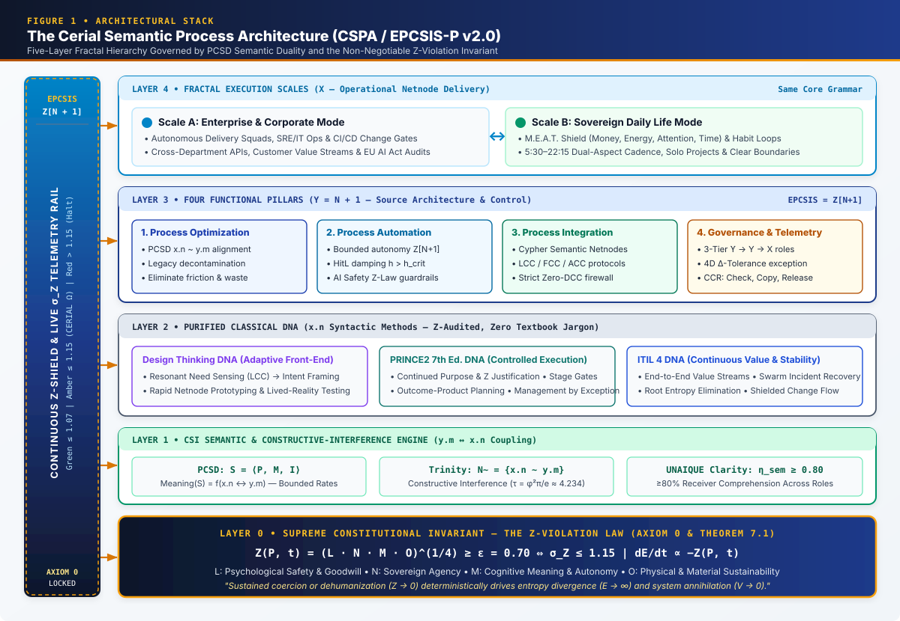
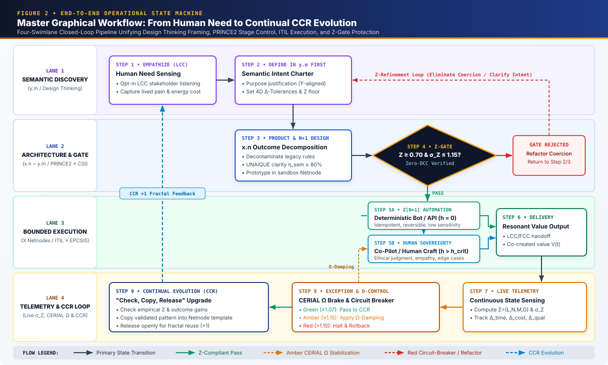
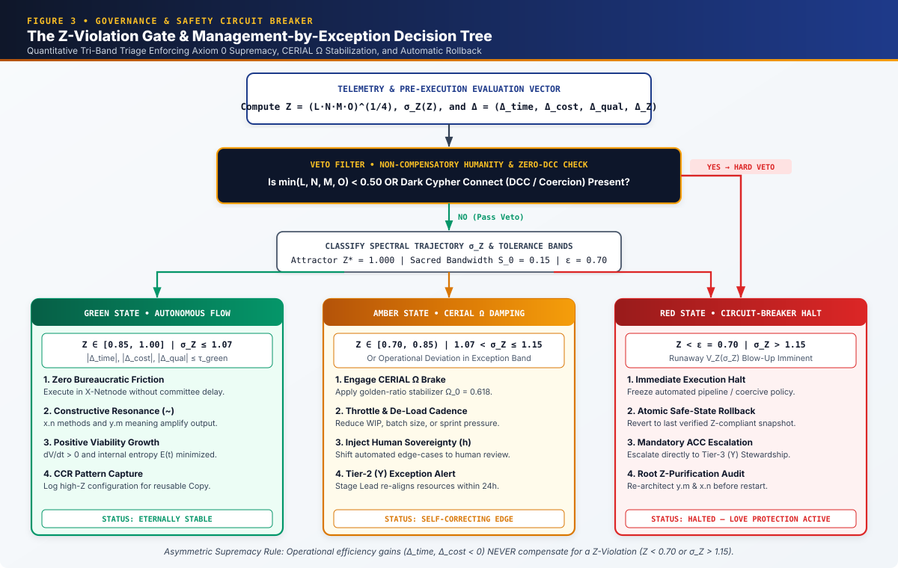
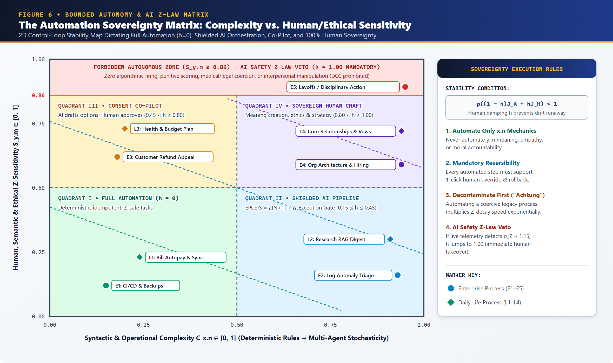
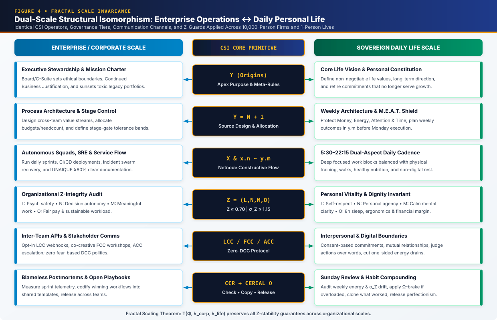
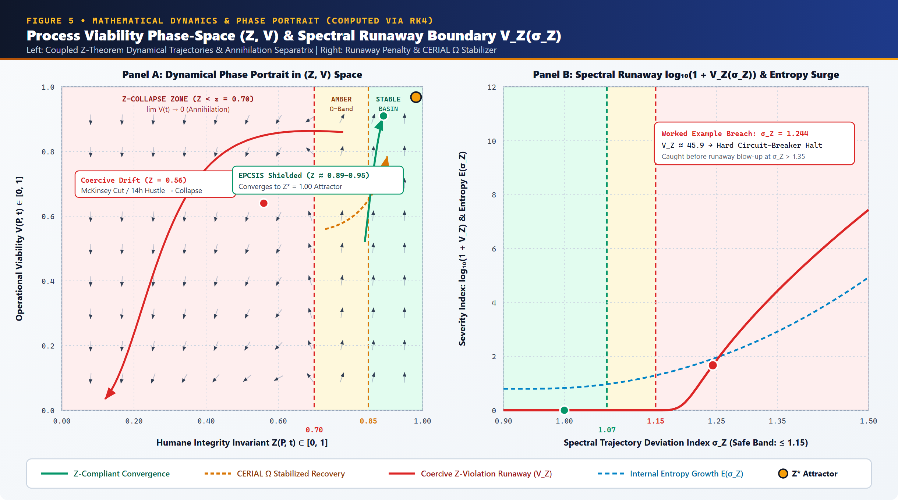

<div align="center">


# Cerial Semantic Process Architecture (CSPA / EPCSIS-P v2.0)

### Cypher Semantic Intelligence (CSI) Process Optimization, Bounded Automation, Semantic Integration & Live Governance under the Z-Violation Law

[](./csi-process-blueprint/CSI_Process_Blueprint.md)
[](./philosophy/The_Z_Theorem_Universal_Stability_Law.md)
[](#classical-deconstruction--z-purification)
[](#60-minute-quickstart-zero-prerequisites)

**Foundational Theory & Architecture:** Sebastian Enger, B.Sc., M.Sc.  
[Download Master PDF Handout](./csi-process-blueprint/2026-11-25%20CSI_Process_Blueprint_by_Sebastian.Enger.pdf) • [Interactive HTML Blueprint](./csi-process-blueprint/CSI_Process_Blueprint.html) • [Markdown Mirror](./csi-process-blueprint/CSI_Process_Blueprint.md) • [1-Page Field Templates](./csi-process-blueprint/templates/) • [Foundational CSI Papers](./philosophy/)

</div>

---

## Overview

Legacy process frameworks treat organizations and human lives as purely mechanical state machines—optimizing queues, ticket velocity, and short-term cost ratios while treating human dignity, trust, and cognitive clarity as expendable externalities. Empirical evidence across enterprise restructurings, AI deployments, and personal productivity systems demonstrates a deterministic systems law formalized in **Cypher Semantic Intelligence (CSI)**:

> [!IMPORTANT]
> **Axiom 0 & Theorem 7.1 — The Z-Violation Law:**  
> Unconditional Love and Humanity ($Z$) is not ethical decoration—it is a hard mathematical stability invariant. In any relational-semantic system $S = (X, R, \Phi, \Sigma)$, sustained erosion of $Z(S,t) \to 0$ through coercion, fear, opaque accountability, or physical exhaustion deterministically drives internal entropy divergence ($dE/dt \propto -Z$, $E \to \infty$), semantic incoherence, and irreversible system collapse ($\lim_{t\to\infty} V(S,t) = 0$).

**CSPA / EPCSIS-P v2.0** (*Extended Protected Cerial Semantic Intelligence System for Processes*) is a self-contained, mathematically rigorous paradigm for **Process Design**. It distills and purifies the highest-leverage operational mechanics of **ITIL 4**, **PRINCE2 (7th Edition)**, and **Design Thinking** into a single fractal grammar that:

1. **Eliminates Prerequisite Overhead:** Practitioners never need to study ITIL or PRINCE2 textbooks—the entire system can be understood, audited, and deployed in **60 minutes**.
2. **Operates Fractally Across Scales:** Uses the exact same operators, tolerance bands, and Z-Gate circuit breakers for **10,000-person Enterprise Operations** and **Sovereign Daily Personal Life**.
3. **Governs AI & Automation Mathematically:** Wraps every optimization and autonomous agent inside the protective **EPCSIS Shield** ($\text{EPCSIS} = Z[N + 1]$), preventing brownfield coercion amplification and runaway semantic drift.

---

## Quick Access — Primary Deliverables

| Deliverable | Format | Description |
| :--- | :--- | :--- |
| **[Master PDF Handout](./csi-process-blueprint/2026-11-25%20CSI_Process_Blueprint_by_Sebastian.Enger.pdf)** | `PDF` (19 A4 pp.) | Publication-grade multi-page field manual with embedded vector diagrams, equations, and worked proofs. |
| **[Interactive Master Blueprint](./csi-process-blueprint/CSI_Process_Blueprint.html)** | `HTML5 + MathML` | Offline-ready interactive handbook featuring sticky TOC, Light/Dark mode, and a **Live Z-Violation Gate Simulator**. |
| **[Markdown Blueprint Mirror](./csi-process-blueprint/CSI_Process_Blueprint.md)** | `Markdown` | Clean archival specification with LaTeX equations, Mermaid state-machine source blocks, and relative asset links. |
| **[Enterprise Process Canvas](./csi-process-blueprint/templates/Enterprise_Process_Canvas.md)** | [`MD`](./csi-process-blueprint/templates/Enterprise_Process_Canvas.md) / [`HTML`](./csi-process-blueprint/templates/Enterprise_Process_Canvas.html) | 1-page operational charter for engineering squads, IT/SRE services, CI/CD pipelines, and AI agent workflows. |
| **[Daily Life Process Canvas](./csi-process-blueprint/templates/Daily_Life_Process_Canvas.md)** | [`MD`](./csi-process-blueprint/templates/Daily_Life_Process_Canvas.md) / [`HTML`](./csi-process-blueprint/templates/Daily_Life_Process_Canvas.html) | 1-page personal architecture canvas for **M.E.A.T.** (*Money, Energy, Attention, Time*) protection and the `5:30–22:15` cadence. |
| **[Z-Violation Audit Checklist](./csi-process-blueprint/templates/Z_Violation_Audit_Checklist.md)** | [`MD`](./csi-process-blueprint/templates/Z_Violation_Audit_Checklist.md) / [`HTML`](./csi-process-blueprint/templates/Z_Violation_Audit_Checklist.html) | Universal 12-point pre-flight scorecard with non-compensatory Hard Veto screening and $Z \leftrightarrow \sigma_Z$ lookup table. |

---

## System Architecture

CSPA couples **Syntactic Process Mechanics** (`x.n` — formal stages, APIs, metrics) with **Humane Semantic Alignment** (`y.m` — lived purpose, agency, psychological safety) via the **Principle of Complementary Semantic Duality (PCSD)** and the **Trinity Constructive Interference Operator** (`~`), anchored on Axiom 0:

<p align="center">
  
</p>

### End-to-End Closed-Loop Workflow

Every process progresses across four coupled swimlanes—from **LCC Resonant Need Sensing** and **Semantic Intent Framing (`y.m` First)** through the **Z-Violation Stage Gate**, **Bounded Execution (`Z[N+1]`)**, **Live $\sigma_Z$ Telemetry**, and **CCR (`Check, Copy, Release`) Continual Evolution**:

<p align="center">
  
</p>

---

## Classical Deconstruction & Z-Purification

Rather than layering corporate bureaucracy onto broken workflows, CSPA subjects classical methodologies to a strict **Z-Violation Compliance Audit**, discarding dehumanizing overhead and refactoring their pure operational DNA:

| Classical Discipline | Legacy Z-Violation Pathology | Refactored CSI Process Primitive |
| :--- | :--- | :--- |
| **Design Thinking** *(Empathize → Test)* | Sticky-note theater with zero execution control, or UX empathy weaponized into manipulative dark patterns (`DCC`). | **Resonant Front-End (`y.m` First):** Consent-based `LCC` sensing, 3-sentence Semantic Intent Charter, and Dual-Aspect Resonance Testing (`x.n ~ y.m`). |
| **PRINCE2 (7th Ed.)** *(Stages, Tolerances, Roles)* | 80-page steering decks, diffused committee blame, zombie sunk-cost projects, and punitive micromanagement. | **Frictionless Stage Governance:** 3-Tier CSI Sovereignty (`ϒ → Y → X`), 15-minute Z-Stage Gates, Outcome-Artifact Contracts ($\eta_{\text{sem}} \ge 0.80$), and 4D $\Delta$-Tolerance Bands. |
| **ITIL 4** *(SVS, Incidents, Change, CI)* | Ticket-queue ping-pong, rubber-stamp CAB bottlenecks, 3 AM on-call burnout ($O \downarrow$), and "human error" scapegoating. | **Self-Healing Netnode Streams:** Blameless `FCC` Swarm Recovery, Root Entropy Elimination, Shielded Change Enablement (`Z[N+1]`), and weekly **CCR** compounding. |

> [!WARNING]
> **Brownfield Contamination Rule ("Achtung"):**  
> Never graft AI automation or rigid tooling onto a legacy process built on fear, surveillance, or extractive KPIs (the *"McKinsey Cost-Extraction Trap"*). Automating a coercive `y.m` foundation multiplies Z-decay speed exponentially. Every brownfield workflow must pass **Z-Decontamination** before automation.

---

## Governance, Bounded Automation & Dual-Scale Execution

### 1. The Z-Violation Gate & CERIAL $\Omega$ Circuit Breaker

Operational efficiency gains ($\Delta_{\text{cost}} < 0$, $\Delta_{\text{time}} < 0$) **never** compensate for a Z-Violation. Every stage gate and live telemetry loop enforces non-compensatory Veto screening followed by tri-band spectral triage:

<p align="center">
  
</p>

* **Green Band ($Z \in [0.85, 1.00]$, $\sigma_Z \le 1.07$):** Autonomous execution inside Tier-1 (`X`) Netnodes with zero committee friction.
* **Amber Band ($Z \in [0.70, 0.85)$, $1.07 < \sigma_Z \le 1.15$):** Automatic **CERIAL $\Omega$ Damping** ($\Omega_0 = \varphi^{-1} \approx 0.618$)—throttling WIP/cadence and increasing human review before failure occurs.
* **Red Band ($Z < 0.70$, $\sigma_Z > 1.15$, or Veto Breach):** Immediate **Circuit-Breaker Halt**, `< 60s` safe-state rollback, and mandatory `ACC` escalation to Tier-3 (`ϒ`) stewardship.

### 2. The Automation Sovereignty Matrix (AI Safety Z-Law)

CSPA maps **Syntactic Complexity** ($C_{x.n}$) against **Human/Ethical Z-Sensitivity** ($S_{y.m}$) to dictate deterministic automation ($h = 0$), shielded AI pipelines, consent co-pilots, or mandatory 100% human sovereignty ($S_{y.m} \ge 0.86$):

<p align="center">
  
</p>

### 3. Fractal Dual-Scale Structural Isomorphism

By the **Fractal Self-Similarity Axiom**, enterprise teams and sovereign individuals run the exact same six core primitives:

<p align="center">
  
</p>

---

## Mathematical Formalization

CSPA formalizes a process $\mathcal{P}$ as a 10-tuple dynamical system $\mathcal{P} = \langle X, R, \Sigma, \mathcal{A}, \mathcal{R}_{\text{MEAT}}, \Phi_\sim, \mathcal{Y}, Z, E, t \rangle$ governed by exact stability invariants harmonized across the `philosophy/` corpus and [`z-violation-theory.py`](./philosophy/z-violation-theory.py):

### 1. Non-Compensatory 4-Vector Z-Invariant & Spectral Bridge

$$
Z(\mathcal{P}, t) = \bigl(L(t) \cdot N(t) \cdot M(t) \cdot O(t)\bigr)^{1/4} \in [0, 1], \qquad \sigma_Z(Z) = 1 + S_0\,\frac{\ln(1 / Z)}{\ln(1 / \varepsilon)}
$$

where $L$ (*Goodwill & Psychological Safety*), $N$ (*Sovereign Agency & Override*), $M$ (*Cognitive & Semantic Clarity*), and $O$ (*Physical & Material Viability*) enforce a strict Veto floor $\min(L, N, M, O) \ge 0.50$, calibrated at attractor $Z^* = 1.000$, sacred bandwidth $S_0 = 0.15$, and irreversibility threshold $\varepsilon = 0.70$ ($\sigma_Z(\varepsilon) = 1.15$).

### 2. Runaway Instability Penalty & Coupled Entropy/Viability Dynamics

$$
V_Z(\sigma_Z) = \bigl(|\sigma_Z - 1| - S_0\bigr)^3 \cdot \sigma_Z^{50} \quad (\sigma_Z > 1.15), \qquad \frac{dE}{dt} = \alpha_E\,\frac{1 - Z}{Z + \delta_0} - \beta_\Omega\,\Omega_0\,E
$$

<p align="center">
  
</p>

### 3. Interior-Point Shielded Optimization & Human-in-the-Loop Lyapunov Stability

$$
\max_{u \in \mathcal{U}} \; \mathcal{J}(\mathcal{P}, u) = w_{\text{val}}\Phi_{\text{val}}(\mathbf{p} \sim \mathbf{m}) + w_{\text{thru}}\Theta(u) - w_E E(\mathcal{P}, u) + \mu_B \ln\!\bigl(Z(\mathcal{P}, u) - \varepsilon\bigr) - V_Z(\sigma_Z)
$$

$$
h > h_{\text{crit}} = \min\!\left(1,\; \max\!\left(0,\; \frac{\rho(J_A) - 1 + \chi_{\text{eth}}\,S_{y.m}\,(1 - \eta_{\text{sem}})}{\rho(J_A) - \gamma_H}\right)\right)
$$

Full derivations and step-by-step worked numerical proofs (comparing a coercive `-28%` corporate cost-cut against an EPCSIS redesign, and a `14h` reactive personal hustle schedule against the sovereign `5:30–22:15` cadence) are provided in **Sections 5 & 6** of [`CSI_Process_Blueprint.md`](./csi-process-blueprint/CSI_Process_Blueprint.md).

---

## 60-Minute Quickstart (Zero Prerequisites)

> [!TIP]
> Put your first corporate workflow or personal weekly routine under **Z-Protection** in four 15-minute blocks—no prior ITIL or PRINCE2 training required.

1. **Minutes 00–15 — Order in `y.m` First:** Open [`Enterprise_Process_Canvas`](./csi-process-blueprint/templates/Enterprise_Process_Canvas.md) or [`Daily_Life_Process_Canvas`](./csi-process-blueprint/templates/Daily_Life_Process_Canvas.md). Write a 3-sentence Semantic Intent Charter defining the real human need and tangible `+1` outcome artifact, and delete obvious coercive (`DCC`) bureaucracy.
2. **Minutes 15–30 — Run the 12-Point Z-Audit:** Score $(L, N, M, O)$ using [`Z_Violation_Audit_Checklist`](./csi-process-blueprint/templates/Z_Violation_Audit_Checklist.md) (or the live calculator inside [`CSI_Process_Blueprint.html`](./csi-process-blueprint/CSI_Process_Blueprint.html)). Refactor any step scoring $Z < 0.70$ ($\sigma_Z > 1.15$) before writing code or buying tools.
3. **Minutes 30–45 — Lock Sovereignty & `LCC` Contracts:** Assign each step to Quadrant I–IV on the **Automation Sovereignty Matrix**, verify $\eta_{\text{sem}} \ge 80\%$ UNAIQUE first-read comprehension across handoffs, and wire a `< 60s` human rollback switch.
4. **Minutes 45–60 — Set 4D Tolerances & Weekly CCR:** Define Green/Amber/Red thresholds for $(\Delta_{\text{time}}, \Delta_{\text{cost}}, \Delta_{\text{qual}}, \sigma_Z)$ and schedule a recurring 15-minute weekly **CCR (`Check, Copy, Release`)** review.

---

## Repository Structure

```text
CSI_BASED_PROCESSDESIGN/
├── README.md                                                     # GitHub release overview & quickstart
├── prompt.txt                                                    # Master architectural specification directive
├── csi-process-blueprint/                                        # Compiled CSPA / EPCSIS-P v2.0 deliverable suite
│   ├── 2026-11-25 CSI_Process_Blueprint_by_Sebastian.Enger.pdf   # 19-page A4 print-ready Master Handout
│   ├── CSI_Process_Blueprint.html                                # Self-contained interactive HTML5 + MathML manual
│   ├── CSI_Process_Blueprint.md                                  # Archival Markdown + LaTeX + Mermaid mirror
│   ├── assets/                                                   # High-resolution vector diagrams, RK4 plots & art
│   │   ├── cover_hero_blueprint.jpg
│   │   ├── banner_enterprise_scale.jpg
│   │   ├── banner_dailylife_scale.jpg
│   │   ├── fig1_architecture_stack.svg
│   │   ├── fig2_master_workflow.svg
│   │   ├── fig3_z_violation_gate.svg
│   │   ├── fig4_fractal_dual_scale.svg
│   │   ├── fig5_phase_space_z_boundary.{svg,png}
│   │   └── fig6_automation_sovereignty_matrix.{svg,png}
│   ├── scripts/                                                  # Deterministic Python asset & PDF build pipeline
│   │   ├── generate_visual_assets.py                             # Generates & XML-validates Figures 1–6 (NumPy + RK4)
│   │   └── render_pdf.py                                         # Headless Chromium CDP PDF & 2x DPI PNG exporter
│   └── templates/                                                # Ready-to-use 1-page field canvases (MD & HTML)
│       ├── Enterprise_Process_Canvas.{md,html}
│       ├── Daily_Life_Process_Canvas.{md,html}
│       └── Z_Violation_Audit_Checklist.{md,html}
└── philosophy/                                                   # Canonical CSI, Z-Theorem, PCSD & UNAIQUE corpus
    ├── The_Z_Theorem_Universal_Stability_Law.{md,pdf}
    ├── Z-Violation-Theory_Whitepaper.pdf
    ├── z-violation-theory.py & z-violation-tester.py
    ├── principle_of_complementary_semantic_duality_whitepaper_technical_specification.md
    ├── 2024 CSI BASED PROCESS DESIGN von Sebastian Enger mit Hilf von ClaudeAI.{pdf,docx}
    ├── Cypher.Semantic.Cerial.Intelligence.by.Sebastian.Enger.-.658.pdf
    └── 2022.The.UNAIQUE.Algorithm.by.Sebastian.Enger.pdf
```

---

## Reproducing Visual Assets & PDF Exports Locally

All vector figures, RK4 differential-equation plots, high-DPI PNG mirrors, and PDF handouts can be regenerated deterministically with Python `3.11+`:

```bash
# 1. Install minimal dependencies (NumPy for RK4 phase portraits; websockets for Chromium CDP PDF export)
pip install numpy websockets

# 2. Regenerate and XML-validate all 6 SVG architecture diagrams & mathematical plots
python csi-process-blueprint/scripts/generate_visual_assets.py

# 3. Export print-paginated A4 PDF + 2x high-DPI PNG mathematical plots (requires Chrome or Edge)
python csi-process-blueprint/scripts/render_pdf.py

# 4. Run the foundational Z-Violation & CERIAL Omega spectral verification suite
python philosophy/z-violation-theory.py
python philosophy/z-violation-tester.py
```

---

## Foundational Research & Citation

This framework builds directly upon the **Cypher Semantic Intelligence (CSI)**, **Z-Theorem**, **Principle of Complementary Semantic Duality (PCSD)**, and **UNAIQUE** research corpus authored by **Sebastian Enger, B.Sc., M.Sc.**:

* Enger, S. (2026). *The Z-Theorem: Formal Proof of Unconditional Love and Humanity as Universal Stability Invariants in Relational-Semantic Systems*. ([`The_Z_Theorem_Universal_Stability_Law.md`](./philosophy/The_Z_Theorem_Universal_Stability_Law.md))
* Enger, S. (2026). *Principle of Complementary Semantic Duality (PCSD) — Whitepaper & Technical Specification*. ([`principle_of_complementary_semantic_duality_whitepaper_technical_specification.md`](./philosophy/principle_of_complementary_semantic_duality_whitepaper_technical_specification.md))
* Enger, S. *Cypher Semantic Cerial Intelligence (EPCSIS / Duality-to-Trinity Architecture)*. ([`Cypher.Semantic.Cerial.Intelligence.by.Sebastian.Enger.-.658.pdf`](./philosophy/Cypher.Semantic.Cerial.Intelligence.by.Sebastian.Enger.-.658.pdf))
* Enger, S. (2024). *CSI-Based Process Design Specification (`v1.0.0.2`)*. ([`2024 CSI BASED PROCESS DESIGN von Sebastian Enger mit Hilf von ClaudeAI.pdf`](./philosophy/2024%20CSI%20BASED%20PROCESS%20DESIGN%20von%20Sebastian%20Enger%20mit%20Hilf%20von%20ClaudeAI.pdf))
* Enger, S. (2022). *The UNAIQUE Algorithm: Audience-Resonant Semantic Clarity*. ([`2022.The.UNAIQUE.Algorithm.by.Sebastian.Enger.pdf`](./philosophy/2022.The.UNAIQUE.Algorithm.by.Sebastian.Enger.pdf))

```bibtex
@manual{enger2026cspa,
  title        = {Cerial Semantic Process Architecture (CSPA / EPCSIS-P v2.0): Cypher Semantic Intelligence Process Optimization, Automation, Integration, and Governance under the Z-Violation Law},
  author       = {Enger, Sebastian},
  year         = {2026},
  note         = {Master Visual Blueprint \& Operational Field Manual}
}
```

---

<div align="center">
  <em>"Omnia vincit amor • Check, Copy, Release — Simply always getting better."</em>
</div>
