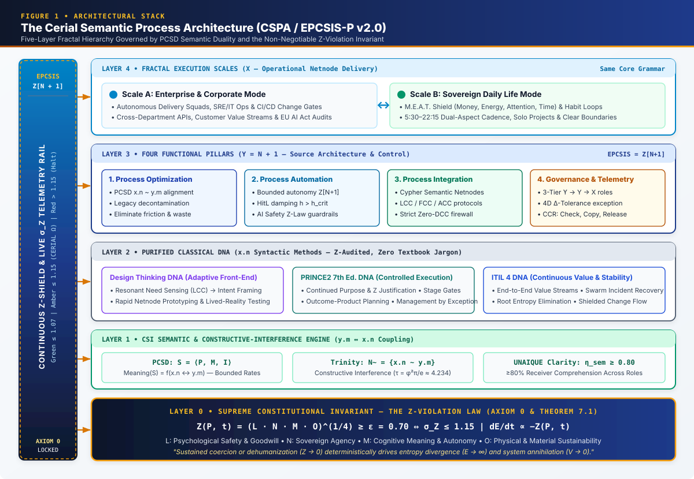
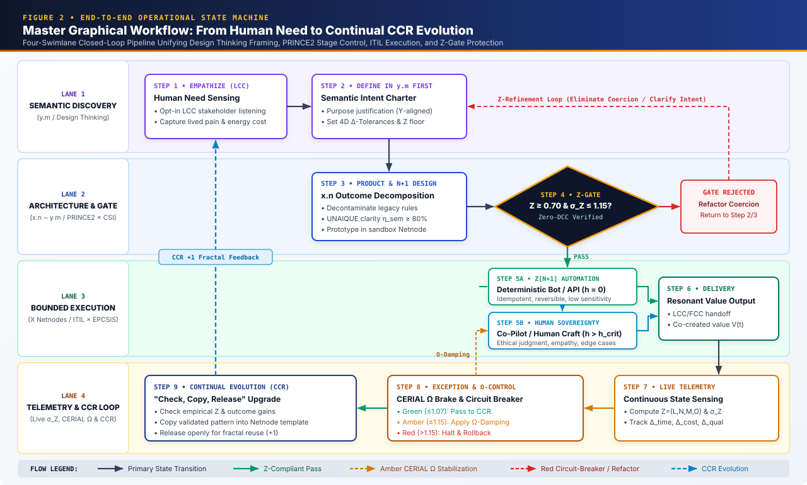
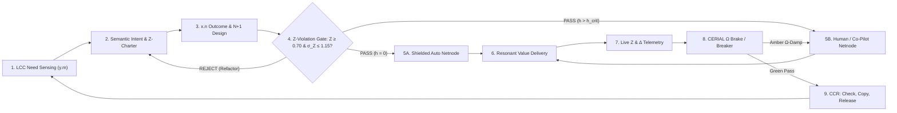
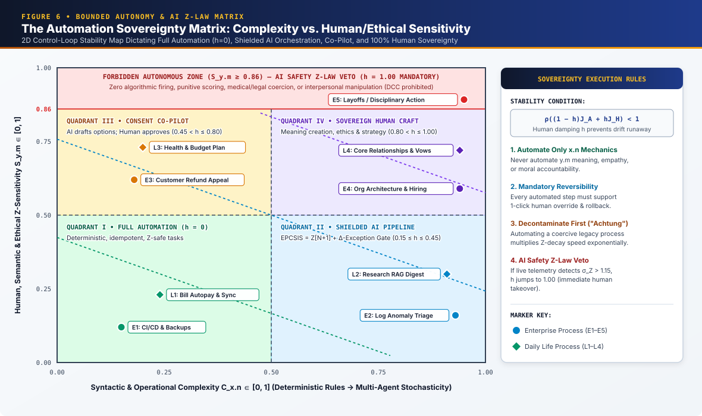
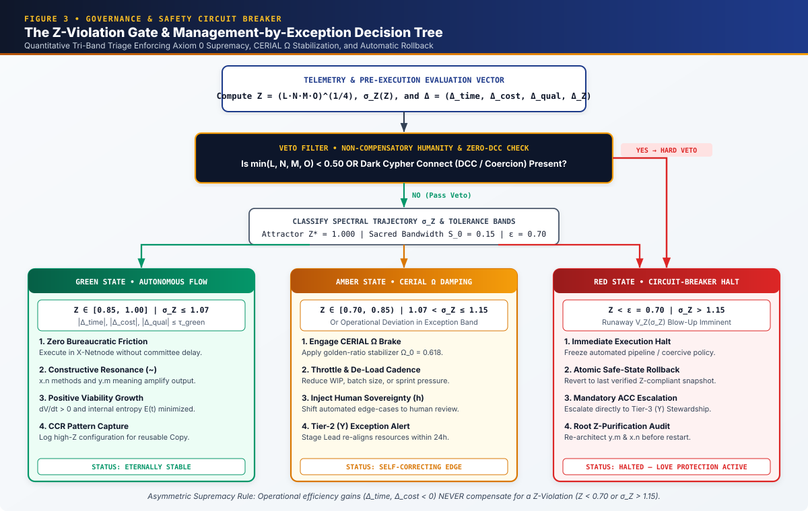
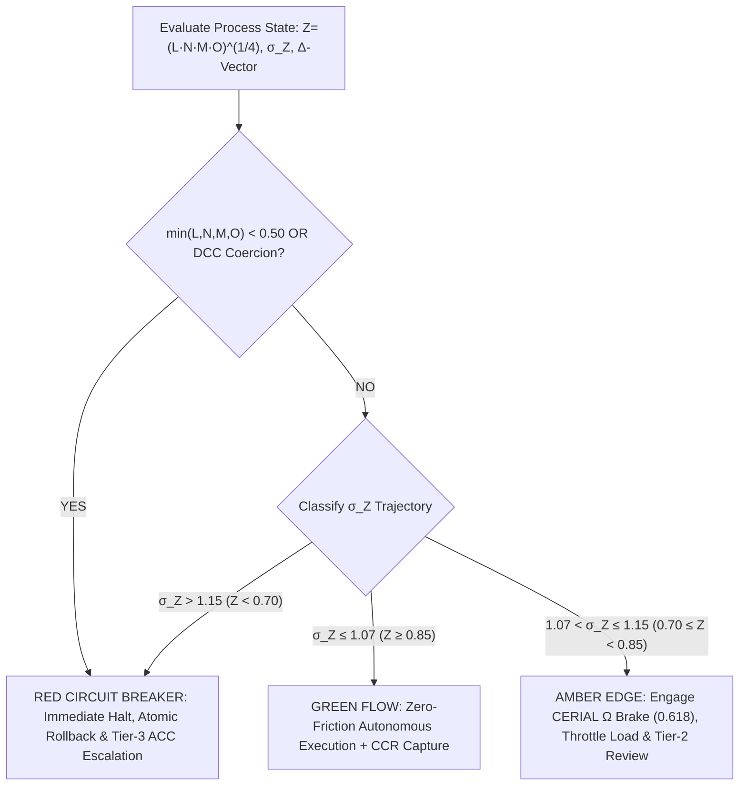
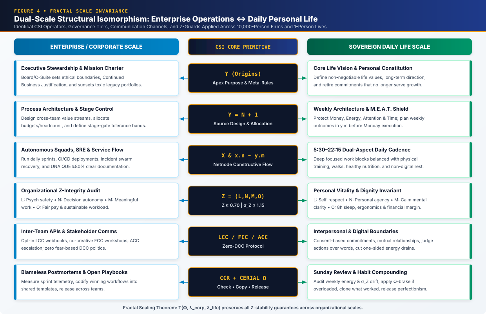
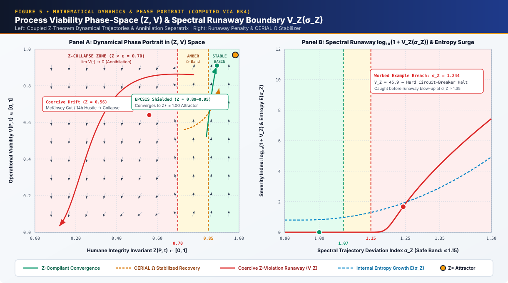

# Cerial Semantic Process Architecture (`CSPA` / `EPCSIS-P v2.0`)

### A Cypher Semantic Intelligence (CSI) Framework & Visual Blueprint for Process Optimization, Bounded Automation, Semantic Integration, and Z-Invariant Governance

**Foundational Philosophy & Mathematical Invariants:** Sebastian Enger, B.Sc., M.Sc. (*Cypher Semantic Intelligence*, 2007–2026)  
**Operational Synthesis:** Unifying Purified **ITIL 4**, **PRINCE2 (7th Edition)**, and **Design Thinking** under the **Z-Violation Law**  
**Scale Domain:** Fractal Dual-Scale Execution — **Enterprise Operations** $\longleftrightarrow$ **Sovereign Daily Life**

> **Supreme Constitutional Law (Axiom 0 — The Z-Violation Law):**  
> *"Unconditional Love and Humanity ($Z$) is not moral ornamentation; it is a non-negotiable structural invariant of complex systems. Every sustained Z-Violation deterministically induces internal entropy divergence and finite-time functional collapse."*  
> — Grounded in `philosophy/The_Z_Theorem_Universal_Stability_Law.md` (§3–§7) & `philosophy/Cypher.Semantic.Cerial.Intelligence.by.Sebastian.Enger.-.658.pdf` (p. 6, p. 38)

---

## Table of Contents

1. [Canonical Ground Truth & Axiom Lock (Zero-Drift Foundation)](#1-canonical-ground-truth--axiom-lock-zero-drift-foundation)
2. [Classical Deconstruction & The Z-Purification Matrix](#2-classical-deconstruction--the-z-purification-matrix)
3. [The Four Functional Pillars of CSPA / EPCSIS-P](#3-the-four-functional-pillars-of-cspa--epcsis-p)
4. [Fractal Dual-Scale Playbooks: Enterprise Mode & Daily Life Mode](#4-fractal-dual-scale-playbooks-enterprise-mode--daily-life-mode)
5. [Mathematical Formalization & Worked Numerical Examples](#5-mathematical-formalization--worked-numerical-examples)
6. [60-Minute Zero-Prerequisite Adoption Guide & Templates](#6-60-minute-zero-prerequisite-adoption-guide--templates)

---

## 1. Canonical Ground Truth & Axiom Lock (Zero-Drift Foundation)

Classical process methodologies fail for a precise structural reason: they optimize **syntactic mechanics** (checklists, tickets, stage documents, cost ratios) while treating **semantic meaning and human integrity** as externalities. When a corporation or an individual optimizes throughput through coercion, opaque bureaucracy, or chronic overload, short-term output masks a fatal decay in systemic viability.

**Cerial Semantic Process Architecture (`CSPA` / `EPCSIS-P v2.0`)** resolves this failure by anchoring process engineering in six canonical principles extracted directly from the `philosophy/` corpus:

### 1.1 Canonical Anchor Map

| CSI Principle / Operator | Mathematical Form | Canonical Source Citation | Operational Meaning in Process Design |
| :--- | :--- | :--- | :--- |
| **System Tuple** | $S = (X, R, \Phi, \Sigma)$ | `The_Z_Theorem_Universal_Stability_Law.md` (§2, Def. 2.1); `Z-Theorem.docx` (§1) | Every process consists of elements $X$, relations $R$, dynamics $\Phi$, and a living **semantic state space** $\Sigma$ (intent, meaning, agency). |
| **Complementary Semantic Duality (PCSD)** | $S = \langle P, M, I \rangle$, $\text{Meaning}(S) = f(P \leftrightarrow M)$ | `principle_of_complementary_semantic_duality_whitepaper_technical_specification.md` (§3–§4, §7) | Formal process methods ($P \equiv x.n$) and human meaning ($M \equiv y.m$) must interact via bounded coupling $I$. $P$-only creates bureaucratic noise; $M$-only creates ungrounded wishful thinking. |
| **Duality-to-Trinity Constructive Binding** | $N = \{x.n, y.m\} \to N_\sim = \{x.n \sim y.m\}$ | `2024 CSI BASED PROCESS DESIGN...pdf` (p. 2 handwritten spec v1.0.0.2); `Cypher.Semantic...658.pdf` (pp. 37, 41, 208–211) | `ITIL + PRINCE2 + Design Thinking` form the $x.n$ methodological substrate; `CSI (N, Y, Z)` forms the $y.m$ humane-semantic core. Optimal processes run in the balanced **`~`** constructive-interference state. |
| **4-Vector Humanity Invariant ($Z$)** | $Z = (L, N, M, O) \in [0,1]$ | `Cypher.Semantic...658.pdf` (p. 38 / Dossier p. 34); `Z-Violation-Theory_Whitepaper.pdf` (§2–§3) | **L**ove (goodwill & psychological safety), **N** (sovereign agency/force), **M**ental (cognitive clarity & spirit), **O** (physical & material sustainability). Violation of *any* element collapses $Z$. |
| **Spectral Trajectory & CERIAL $\Omega$ Brake** | $Z^* = 1.000, \; S_0 = 0.15, \; \Omega_0 = 0.618$ | `z-violation-theory.py` (ll. 14–53); `Z-Violation-Theory.txt` (ll. 24–60) | $\sigma_Z \le 1.07$: Eternally Stable (Green); $1.07 < \sigma_Z \le 1.15$: Edge Band stabilized by $\Omega$; $\sigma_Z > 1.15$: Runaway collapse $V_Z(\sigma_Z)$ (Red Circuit-Breaker). |
| **EPCSIS Shielded Innovation** | $\text{EPCSIS} = Z[N + 1] = Z[Y]$ | `Cypher.Semantic...658.pdf` (pp. 42–43 / Dossier pp. 38–39) | Every creative optimization or automation step ($Y = N + 1$) must be enveloped inside the protective Z-Shield $Z[\cdot]$. |
| **UNAIQUE Clarity & CCR Evolution** | $\eta_{\text{sem}} \ge 0.80$; $\text{CCR}(I) = R(C_2(C_1(I)))$ | `2022.The.UNAIQUE.Algorithm...pdf` (p. 2); `Cypher.Semantic...658.pdf` (pp. 2, 62, 74, 259) | Interfaces and instructions must transfer $\ge 80\%$ comprehension to each receiver persona; improvements compound via **Check, Copy, Release (`CCR`)**. |

### 1.2 The Five Non-Negotiable Laws of CSI Process Engineering

1. **Law 1 — Semantic Ordering Precedes Physical Execution ($y.m \to x.n$):** Derived from `Cypher.Semantic...658.pdf` (p. 52 / Dossier p. 48) and `2024 CSI BASED PROCESS DESIGN...pdf` (p. 3): no workflow, software tool, or habit is built in the physical/syntactic plane ($x.n$) until its purpose, human impact, and Z-boundaries are coherently ordered in the semantic plane ($y.m$).
2. **Law 2 — Non-Compensatory Z-Supremacy (Axiom 0 & Theorem 7.1):** Operational speed or cost savings never compensate for a Z-Violation. When coercion or instrumentalization drives $Z(S,t) \to 0$, internal entropy grows ($dE/dt \propto -Z$), semantic coherence $\Sigma$ fractures, and viability $V(S,t) \to 0$ deterministically.
3. **Law 3 — The "McKinsey Extraction" Prohibition & Legacy Decontamination (*"Achtung"* Rule):** Directly codifying Sebastian Enger's `21.11.2024` handwritten analysis (`2024 CSI BASED PROCESS DESIGN...pdf`, p. 2):
   * *The Extraction Trap:* Declaring an operational process "too expensive" and cutting front-line human staff solely to manufacture short-term executive/shareholder bonuses violates $Z$ (specifically collapsing $L$ and $O$), injecting destructive organizational dissonance (*"bad vibes"* / high entropy) that guarantees long-term corporate failure.
   * *The Decontamination Gate:* Attaching a new CSI workflow or AI agent onto a legacy process built on an unbalanced $y.m$ (`+` manic hype or `-` fear-based control) contaminates the new system. Legacy processes must be stripped of coercive incentives *before* integration or automation.
4. **Law 4 — Formal AI & Automation Safety Law (`Z-Theorem` §9):** No automated script, ERP rule, or AI agent may enforce alignment or decisions that push $Z < \varepsilon$ ($\sigma_Z > 1.15$). High-sensitivity human outcomes remain permanently under human sovereignty.
5. **Law 5 — Zero-`DCC` Communication Hygiene:** Inter-process and interpersonal links operate exclusively via consent-based **Light Cypher Connect (`LCC`)**, co-creative **Force Cypher Connect (`FCC`)**, or high-integrity governance **Aligned Cypher Connect (`ACC`)**. Coercive **Dark Cypher Connect (`DCC`)**—fear management, dark patterns, deceptive metrics, or unreciprocated energy extraction—is structurally banned.

---

## 2. Classical Deconstruction & The Z-Purification Matrix

You never need to read a single page of an ITIL 4 or PRINCE2 manual to run `CSPA / EPCSIS-P`. Below, the pure operational DNA of **Design Thinking**, **PRINCE2 (7th Edition)**, and **ITIL 4** has been extracted, audited against the Z-Violation Law, stripped of bureaucratic jargon, and refactored into **15 ready-to-execute CSI Process Primitives**.

### 2.1 Translation & Purification Matrix

| Source Discipline | Classical Primitive | Legacy Failure / Z-Violation Mode in Practice | Refactored CSI Process Primitive (Zero-Jargon, Z-Compliant) |
| :--- | :--- | :--- | :--- |
| **Design Thinking** | **1. Empathize** | Superficial "empathy workshops" used to extract data or design addictive/manipulative UX dark patterns (`DCC`, $L \downarrow$). | **Resonant Need Sensing (`LCC` Listening):** Opt-in observation of real human pain, cognitive load, and energy friction before proposing tools. |
| **Design Thinking** | **2. Define** | Framing problems solely around internal corporate cost/conversion KPIs while ignoring human externalities ($y.m$ blind spot). | **Semantic Intent Charter ($y.m$ First):** 3-sentence statement of human need, `+1` value target, and hard $Z=(L,N,M,O)$ floor. |
| **Design Thinking** | **3. Ideate** | Unbounded brainstorming theater ($M$-only hallucination in PCSD) producing hundreds of sticky notes and zero execution. | **`N + 1` Generative Option Synthesis:** Generate 3 concrete architectural options that create net-new value without zero-sum harm. |
| **Design Thinking** | **4. Prototype** | Shipping half-baked MVPs straight into production on live staff/customers without rollback protection. | **Sandbox Netnode Trial:** Test changes inside an isolated, reversible Cypher Semantic Netnode (`X`) with blast-radius containment. |
| **Design Thinking** | **5. Test** | Measuring only click-through or speed ($x.n$) while ignoring user frustration or operator burnout ($y.m$). | **Dual-Aspect Resonance Validation ($x.n \sim y.m$):** Validate *both* quantitative output and human $Z$-score before scaling. |
| **PRINCE2 (7th Ed.)** | **6. Continued Business Justification** | Sunk-cost zombie projects kept alive for executive ego, or ruthless ROI cuts that destroy human trust ($\sigma_Z > 1.15$). | **Live Purpose & Z-Justification:** Every active process must continuously prove *both* genuine value delivery and $Z \ge 0.70$, or be cleanly sunsetted. |
| **PRINCE2 (7th Ed.)** | **7. Defined Roles & Responsibilities** | Diffused committee accountability ("nobody decided, everybody attended") paired with scapegoating junior staff ($N \to 0$). | **3-Tier CSI Sovereignty ($\Upsilon / Y / X$):** Unambiguous single-point stewardship: $\Upsilon$ (Purpose/Ethics), $Y$ (Architecture/Stage), $X$ (Execution). |
| **PRINCE2 (7th Ed.)** | **8. Product-Based Planning** | Activity-tracking micromanagement (counting hours, keystrokes, status meetings) instead of clear deliverables ($M, N \downarrow$). | **Outcome-Artifact Contracts:** Define the exact finished artifact and its UNAIQUE $\eta_{\text{sem}} \ge 80\%$ acceptance criteria; leave execution method free. |
| **PRINCE2 (7th Ed.)** | **9. Manage by Stages** | Heavyweight waterfall gate committees requiring 80-page slide decks and weeks of waiting ($dE/dt \uparrow$). | **Lightweight Z-Stage Gates:** 15-minute pre-flight gate verifying outcome readiness, rollback safety, and $Z \ge 0.70$ ($\sigma_Z \le 1.15$). |
| **PRINCE2 (7th Ed.)** | **10. Manage by Exception** | Constant leadership hovering when things are fine, followed by punitive panic when targets slip (`DCC` fear loop). | **4D Tolerance Bands ($\mathbf{\Delta}$):** Zero management interference inside Green bands; automatic CERIAL $\Omega$ damping in Amber; Circuit-Breaker in Red. |
| **ITIL 4** | **11. Service Value System & Chain** | Departmental silos optimizing local ticket queues while the end-to-end human experience breaks down. | **End-to-End Value-Resonance Stream:** Map the complete chain from initial human need to realized relief across coupled Netnodes. |
| **ITIL 4** | **12. Incident Management** | Ticket ping-pong across Tier 1/2/3 queues, scripted robotic replies, and overnight on-call exhaustion ($O \downarrow$). | **Blameless Swarm Restoration:** Immediate cross-functional swarming to restore service, paired with protected on-call rotation budgets. |
| **ITIL 4** | **13. Problem Management** | Superficial "human error" blame reports that leave coercive workload or brittle tooling untouched. | **Root Entropy & Z-Decay Elimination:** Trace recurring failures to structural $x.n / y.m$ misalignment or latent Z-Violations and fix the root cause. |
| **ITIL 4** | **14. Change Enablement** | Rubber-stamp Change Advisory Boards (CABs) that slow safe changes while missing systemic ethical/human impact. | **EPCSIS Shielded Transition ($Z[N+1]$):** Automated pre-checks for low-risk $x.n$ changes; mandatory Z-Gate audit for human-impacting changes. |
| **ITIL 4** | **15. Continual Improvement** | Endless top-down "transformation initiatives" causing change fatigue without retiring obsolete rules. | **The `CCR` Loop (*Check, Copy, Release*):** Measure live telemetry (**Check**), codify proven high-$Z$ patterns (**Copy**), share openly & prune dead weight (**Release**). |

### 2.2 Master End-to-End Workflow Architecture

---

## 3. The Four Functional Pillars of CSPA / EPCSIS-P

### Pillar 1 — Process Optimization (Semantic & Structural Refinement)
Optimization in CSI never means squeezing humans harder; it means converting **destructive interference** (ambiguity, rework, fear, misaligned incentives) into **constructive interference** ($x.n \sim y.m$):
1. **Brownfield Decontamination Audit:** Inspect every inherited step and ask two questions: *(a) Does this create real human/customer value ($y.m$)?* *(b) Does it rely on fear, opacity, or unpaid human spillover (`DCC`)?* Delete bureaucratic theater first; refactor coercive steps second.
2. **PCSD Balance Tuning (`+ / ~ / -`):** Diagnose whether the process suffers from **Syntactic Dominance (`P-only`)**—rigid forms nobody reads—or **Semantic Dominance (`M-only`)**—vague vision statements with no clear owner or artifact. Bind every $y.m$ intent to one crisp $x.n$ deliverable (`~` state).
3. **UNAIQUE $\ge 80\%$ Comprehension Standard:** Rewrite SOPs, API specs, user prompts, and personal checklists in direct, unambiguous language tailored to the receiver's role so $\eta_{\text{sem}} \ge 0.80$ on first read—eliminating back-and-forth clarification loops.

### Pillar 2 — Process Automation (Bounded Autonomy under `EPCSIS = Z[N+1]`)
Automation amplifies whatever structure it touches: automating a Z-compliant $x.n$ task liberates human energy; automating a Z-violating process accelerates systemic collapse. `CSPA` enforces four crisp **Automation Sovereignty Quadrants** mapped by **Syntactic Complexity ($C_{x.n}$)** and **Human/Ethical Sensitivity ($S_{y.m}$)**:

* **Quadrant I — Full Deterministic Automation ($h = 0$):** Low complexity, low ethical sensitivity ($S_{y.m} < 0.50$). Tasks must be deterministic, idempotent, auditable, and 1-click reversible (e.g., CI/CD test suites, backups, schema validation, recurring bill autopay).
* **Quadrant II — Shielded AI Orchestration ($0.15 \le h \le 0.45$):** High operational complexity, low-to-moderate human sensitivity. Multi-LLM or agentic pipelines (`n8n`, RAG, log triage) execute inside an `EPCSIS = Z[N+1]` wrapper that routes anomalies or $\sigma_Z > 1.07$ edge cases to humans.
* **Quadrant III — Consent Co-Pilot ($0.45 < h \le 0.80$):** Low-to-moderate complexity, high human sensitivity ($0.50 \le S_{y.m} < 0.86$). AI synthesizes context and drafts options, but an accountable human explicitly reviews and signs off before external action (e.g., customer dispute resolution, medical/financial planning).
* **Quadrant IV — 100% Sovereign Human Craft ($h = 1.00$) & The AI Z-Law Veto Strip ($S_{y.m} \ge 0.86$):** High complexity and/or supreme human sensitivity. Moral judgment, organizational leadership, termination/disciplinary decisions, crisis empathy, and intimate human bonds are **never delegated to autonomous execution**.

### Pillar 3 — Process Integration (Cypher Semantic Netnodes & Zero-`DCC` Interoperability)
Instead of brittle point-to-point spaghetti integrations or coercive cross-team dependencies, every team, microservice, habit, or tool is encapsulated as a **Cypher Semantic Netnode (`CSN`)** exposing a standardized 4-part contract:
1. **Input/Output Schema (`x.n`) + Intent Tag (`y.m`):** Every webhook, API payload, or team handoff carries *what* is requested, *why* it matters, and *explicit acceptance criteria*.
2. **Three Sanctioned CSI Channels (and One Banned Channel):**
   * **`LCC` (Light Cypher Connect — Default Async Sync):** Permissioned, opt-in, low-overhead event streams and pull-based queues (webhooks, clean ticket intake, async status updates) that never interrupt deep focus unnecessarily.
   * **`FCC` (Force Cypher Connect — Generative Co-Creation):** High-bandwidth collaborative sessions or multi-agent synthesis pipelines expressly chartered to produce an `N + 1` breakthrough across domains.
   * **`ACC` (Aligned Cypher Connect — High-Priority Escalation):** Reserved strictly for Stage Gates, major incidents, and Z-Violation Circuit-Breaker alerts requiring immediate sovereign decision-making.
   * **`DCC` (Dark Cypher Connect — BANNED):** Undocumented shadow dependencies, passive-aggressive CC chains, guilt/fear escalation, vendor lock-in traps, or manipulative nudges.
3. **Anti-Fragile Bulkheads:** Every Netnode defines an explicit fallback buffer (graceful degradation, queue backpressure, or local cache) so an upstream outage or personal disruption never cascades into systemic collapse.

### Pillar 4 — Process Management & Governance (3-Tier Hierarchy, Tolerance Bands & `CCR`)
Governance operates frictionlessly through three fractal tiers and automated exception triage:
* **Tier 3 — Apex Stewardship ($\Upsilon$ / Origins Layer):** Owns constitutional purpose, portfolio boundaries, and Z-Axiom enforcement. Intervenes *only* at Stage Gates or Red Circuit-Breaker escalations.
* **Tier 2 — Source Architecture ($Y$ / Creator Layer):** Designs value streams, allocates budgets/`M.E.A.T.`, calibrates tolerance bands, and resolves Amber exceptions via the **CERIAL $\Omega$ Stabilizer** ($\Omega_0 = 0.618$).
* **Tier 1 — Netnode Execution ($X$ / Delivery Layer):** Runs daily operations autonomously within Green tolerance bands with zero micromanagement, closing every cycle with **`CCR` (*Check, Copy, Release*)**.

---

## 4. Fractal Dual-Scale Playbooks: Enterprise Mode & Daily Life Mode

A defining property of `CSPA / EPCSIS-P` is **fractal scale invariance** (`Cypher.Semantic...658.pdf`, p. 202, Axiom 1.2): the exact same operators govern a 5,000-person enterprise and a 1-person daily life.

### 4.1 Scale A — Enterprise & Corporate Playbook

| Operational Module | Concrete Enterprise Execution Playbook |
| :--- | :--- |
| **1. Strategic Portfolio & Change Gate** | Every project charter requires a 1-page `Enterprise Process Canvas`. Before budget or CI/CD production release is approved, the **Z-Gate** verifies $Z \ge 0.70$ across employees and customers. Cost-cutting proposals that rely on unpaid overtime, understaffed support queues, or dark-pattern retention fail Veto 1/2 automatically. |
| **2. Product & Engineering Delivery** | Break initiatives into 2-to-4-week bounded stages with **Outcome-Artifact Contracts** (working software, verified documentation at $\eta_{\text{sem}} \ge 0.80$). Inside Green bands ($\Delta_{\text{time}} \le 15\%, \Delta_{\text{cost}} \le 10\%, Z \ge 0.85$), squads deploy with zero status-meeting overhead. |
| **3. SRE, Incident & Problem Ops** | Replace Tier-1/2/3 ticket ping-pong with **Blameless Swarm Channels (`FCC`)** for P1/P2 incidents. Enforce hard on-call recovery budgets ($O$-protection). Post-incident reviews ban "human error" conclusions and trace every outage to missing `x.n` guardrails or excessive cognitive load ($M$). |
| **4. AI & Multi-LLM Governance** | Wrap every RAG/agentic workflow (`n8n`, customer bots, internal copilots) in a live Z-Telemetry filter (`z-violation-theory.py` architecture): audit prompts/outputs for truthfulness and non-manipulation, log provenance for GDPR / EU AI Act compliance, and provide a `< 60`s human takeover switch. |
| **5. Sprint `CCR` Compounding** | End every sprint with a 20-minute **Check, Copy, Release**: *Check* telemetry ($\mathbf{\Delta}, Z$), *Copy* any workflow script or checklist that improved clarity/throughput into the company playbook repo, and *Release* (delete) at least one obsolete meeting or legacy approval rule. |

### 4.2 Scale B — Sovereign Daily Personal Life Playbook

| Personal Module | Concrete Daily Life Execution Playbook |
| :--- | :--- |
| **1. `M.E.A.T.` Resource Shield** | Derived from `Cypher.Semantic...658.pdf` (p. 8): treat **M**oney, **E**nergy, **A**ttention, and **T**ime as finite sacred capital. Never accept an external commitment (`LCC` request) before checking its cost against your weekly `M.E.A.T.` caps. Single-task strictly (`1 mission per time block`). |
| **2. Ordering in $y.m$ Before $x.n$** | Never open email, social feeds, or reactive chat in the first 60 minutes of the day. Spend 10 quiet minutes ordering your semantic intent ($y.m$): confirm *why* today's primary outcome matters and verify you are acting from calm sovereignty rather than anxiety or ego validation. |
| **3. The `5:30–22:15` Dual-Aspect Cadence** | Directly operationalizing Sebastian Enger's empirical daily structure (`Cypher.Semantic...658.pdf`, p. 46): • **05:30–07:00 (`O + y.m` Grounding):** Wake, mobility & light resistance (`2×5kg`), clean hydration & breakfast. • **07:00–17:30 (`x.n ~ y.m` Execution):** Focused professional/creative Netnode blocks with clear scope. • **18:00–20:30 (`O` Decompression):** Hard work cutoff, shower, 45-min outdoor walk, fresh cooked dinner. • **21:00–22:15 (`M + L` Analog Rest):** Physical book reading, offline sport (badminton/chess), family/gratitude, phone parked outside bedroom for 8h restorative sleep. |
| **4. Interpersonal & Digital `LCC` Hygiene** | Enforce strict anti-`DCC` boundaries (`Cypher.Semantic...658.pdf`, pp. 8, 46): • Zero one-sided communication or unreciprocated emotional chasing. • Evaluate people and partnerships by consistent actions ($x.n$), never flattering words alone. • Release outcomes you cannot control (*"What you love, let be free—otherwise it becomes Force, not Love"*). |
| **5. Personal CERIAL $\Omega$ Brake & Sunday `CCR`** | Track your personal $Z=(L,N,M,O)$ every Sunday evening in 10 minutes. If sleep drops, irritability rises, or workouts get skipped ($1.07 < \sigma_Z \le 1.15$), activate the **CERIAL $\Omega$ Brake**: cut Monday–Wednesday discretionary tasks by $38.2\%$ ($1 - \Omega_0$) until $O$ and $M$ rebound above $0.85$. |

---

## 5. Mathematical Formalization & Worked Numerical Examples

To elevate Process Design from a soft advisory craft into an **exact engineering discipline**, `CSPA / EPCSIS-P` formalizes state transitions, Z-stability boundaries, optimization barriers, exception tolerances, and automation damping in rigorous dynamical systems mathematics.

### 5.1 Process State-Space & Trinity Constructive Interference

Extending `The_Z_Theorem_Universal_Stability_Law.md` (Def. 2.1) and `PCSD` (§4.1), a CSI Process $\mathcal{P}$ over time $t \in \mathbb{R}_{\ge 0}$ is a 10-tuple:

$$\mathcal{P} = \langle X, R, \Sigma, \mathcal{A}, \mathcal{R}_{\text{MEAT}}, \Phi_{\sim}, \mathcal{Y}, Z, E, t \rangle$$

where:
* $X = P \times M$ is the dual-aspect state manifold pairing **syntactic/physical state vectors** $\mathbf{p}(t) \in P \subseteq \mathbb{R}^n$ (`x.n` methods, queues, artifacts) with **semantic/humane state vectors** $\mathbf{m}(t) \in M \subseteq \mathbb{R}^m$ (`y.m` intent, clarity, morale).
* $R \subseteq X \times X \times \{\text{LCC}, \text{FCC}, \text{ACC}\}$ is the directed Cypher Semantic Netnode relational graph (with $\text{DCC} = \varnothing$ enforced by constraint).
* $\Sigma$ is the semantic interpretation space governed by the **UNAIQUE Comprehension Fidelity** functional $\eta_{\text{sem}}: R \to [0, 1]$, subject to $\eta_{\text{sem}}(e) \ge 0.80 \;\; \forall e \in R$.
* $\mathcal{A} = \mathcal{A}_H \cup \mathcal{A}_M$ partitions sovereign human actors ($\mathcal{A}_H$) and bounded machine/AI agents ($\mathcal{A}_M$), parameterized by human sovereignty fraction $h \in [0, 1]$.
* $\mathcal{R}_{\text{MEAT}}(t) \in \mathbb{R}_{\ge 0}^4$ tracks finite **M**oney, **E**nergy, **A**ttention, and **T**ime budgets.
* $\Phi_{\sim}: X \times \mathcal{U} \times \mathbb{R}_{\ge 0} \to X$ is the **Trinity Constructive-Interference Transition Operator** (`Cypher.Semantic...658.pdf`, pp. 209–211):

$$\Psi_{\text{proc}}(t) = \Psi_{x.n}(t) \sim \Psi_{y.m}(t), \qquad \lvert \Psi_{x.n} \sim \Psi_{y.m} \rvert = \lvert \Psi_{x.n} \rvert \lvert \Psi_{y.m} \rvert \Big(1 + \sin\big(\tau \phi(\Psi_{x.n}, \Psi_{y.m})\big)\Big)$$

with canonical Trinity coupling constant $\tau = \frac{\varphi^2 \pi}{e} \approx 4.2343$ ($\varphi = \frac{1+\sqrt{5}}{2}$). When syntactic execution $\Psi_{x.n}$ and human meaning $\Psi_{y.m}$ are phase-aligned ($\tau \phi \to \pi/2$), constructive interference **doubles effective value amplitude**; when misaligned through bureaucratic hypocrisy or coercion ($\tau \phi \to -\pi/2$), destructive interference cancels output into friction and waste.
* $\mathcal{Y}(t)$ is the verifiable outcome-artifact stream, $Z(\mathcal{P},t) \in [0,1]$ is the **Z-Integrity Invariant**, and $E(\mathcal{P},t) \in \mathbb{R}_{\ge 0}$ is internal organizational/cognitive entropy.

---

### 5.2 The Z-Violation Invariant, Spectral $\sigma_Z$ Isomorphism & Stability Proof

From `Cypher.Semantic...658.pdf` (p. 38), *"Violation of one or more of the 4 'Z' elements (L, N, M, O) leads to destruction."* An arithmetic mean falsely allows high pay ($O=1$) to mask total psychological abuse ($L=0$). Therefore, `CSPA` defines $Z(\mathcal{P},t)$ via the **weighted non-compensatory geometric invariant**:

$$Z(\mathcal{P}, t) = L(t)^{w_L} \cdot N(t)^{w_N} \cdot M(t)^{w_M} \cdot O(t)^{w_O}, \qquad w_L + w_N + w_M + w_O = 1, \; w_k > 0$$

With balanced default weights $w_L = w_N = w_M = w_O = \frac{1}{4}$:

$$Z(\mathcal{P}, t) = \big(L(t) \cdot N(t) \cdot M(t) \cdot O(t)\big)^{1/4} \in [0, 1]$$

If *any* component approaches $0$, $Z(\mathcal{P},t) \to 0$ identically, accompanied by the hard component floor $\min(L, N, M, O) \ge 0.50$.

#### Exact Bijective Bridge to `z-violation-theory.py` ($\sigma_Z$ & CERIAL $\Omega$)
To unify $Z \in [0, 1]$ (`The_Z_Theorem_Universal_Stability_Law.md`) with the spectral deviation metric $\sigma_Z \ge 1$ (`z-violation-theory.py`, constants $Z^* = 1.000$, $S_0 = 0.15$, $\Omega_0 = 0.618$), we establish the exact logarithmic isomorphism calibrated at the critical irreversibility threshold $\varepsilon = 0.70$:

$$\sigma_Z(Z) = 1 + S_0 \frac{\ln(1 / Z)}{\ln(1 / \varepsilon)} = 1 + 0.15 \frac{\ln(1 / Z)}{\ln(1 / 0.70)} \approx 1 - 0.42055 \ln(Z)$$

and its exact inverse $Z(\sigma_Z) = \varepsilon^{(\sigma_Z - 1)/S_0} = 0.70^{(\sigma_Z - 1)/0.15}$. Checking every canonical boundary:
1. **Perfect Humanity Fixed Point:** $Z = 1.000 \iff \sigma_Z = 1.000 = Z^*$.
2. **Green Eternal-Stability Band:** $Z \in [0.8465, 1.000] \approx [0.85, 1.00] \iff \sigma_Z \in [1.000, 1.070]$.
3. **Amber Edge-of-Tolerance Band:** $Z \in [0.700, 0.850) \iff \sigma_Z \in (1.070, 1.150]$, where $|\sigma_Z - Z^*| \le S_0 = 0.15$ activates the **CERIAL $\Omega$ Hyperfactorial Stabilizer** (`z-violation-theory.py`, ll. 36–44):

$$\Omega_{\text{brake}}(\sigma_Z) = \frac{\Omega_0}{D} \sum_{k=1}^{D} \sigma_Z^{\,\psi_k}, \qquad \Omega_0 = \varphi^{-1} \approx 0.618, \quad \psi_k = \min\left(\psi_{\max}, \frac{k!}{S_0^k}\right)$$

4. **Red Z-Violation Collapse Region:** $Z < \varepsilon = 0.700 \iff \sigma_Z > 1.150$, triggering the **Omnipotence Runaway Penalty** (`z-violation-theory.py`, ll. 48–52):

$$V_Z(\sigma_Z) = \begin{cases} 0, & \text{if } |\sigma_Z - 1| \le S_0 = 0.15 \\[6pt] \big(|\sigma_Z - 1| - S_0\big)^3 \cdot \sigma_Z^{50}, & \text{if } |\sigma_Z - 1| > 0.15 \end{cases}$$

#### Coupled Entropy–Viability Dynamical System (Proof of Operational Z-Theorem)
System evolution obeys the coupled differential system encoding Axioms 1–3:

$$\frac{dZ}{dt} = \kappa_{\sim}(1 - Z) u_{\text{align}}(t) - \kappa_{\text{DCC}} C_{\text{coer}}(t)$$

$$\frac{dE}{dt} = \alpha_E \frac{1 - Z(t)}{Z(t) + \delta_0} - \beta_\Omega I_{\text{amber}}(\sigma_Z)\Omega_0 E(t)$$

$$\frac{dV}{dt} = \gamma_V \big(Z(t) - \varepsilon\big) V(t)\big(1 - V(t)\big) - \mu_E \max(0, \varepsilon - Z(t)) E(t) V(t)$$

When sustained coercion $C_{\text{coer}}(t) \ge c_0 > 0$ persists, $dZ/dt < 0$ drives $Z(t) < \varepsilon = 0.70$. Immediately, the logistic growth term $\gamma_V(Z - \varepsilon)V(1-V)$ turns strictly negative while internal entropy $E(t)$ surges inversely with $Z(t)$, guaranteeing $\lim_{t\to\infty} V(t) = 0$ (**deterministic process annihilation**).

---

### 5.3 Multi-Objective Optimization with Interior-Point Z-Barrier (`EPCSIS`)

To select an optimal process design or automation policy $u \in \mathcal{U}$, `CSPA` maximizes the **EPCSIS Shielded Objective Functional**:

$$\max_{u \in \mathcal{U}} \; \mathcal{J}(\mathcal{P}, u) = w_{\text{val}} \Phi_{\text{val}}\big(\mathbf{p}(u) \sim \mathbf{m}(u)\big) + w_{\text{thru}} \Theta(u) - w_E E(\mathcal{P}, u) + \mu_B \ln\big(Z(\mathcal{P}, u) - \varepsilon\big) - V_Z\big(\sigma_Z(u)\big)$$

subject to $Z(\mathcal{P}, u) > \varepsilon = 0.70$, $\min(L, N, M, O) \ge 0.50$, and $\eta_{\text{sem}}(u) \ge 0.80$.

**Why Coercive Cost-Cutting Is Mathematically Infeasible:** As any candidate policy $u$ approaches the Z-Violation boundary $Z(\mathcal{P}, u) \to \varepsilon^+ = 0.70^+$, the interior-point logarithmic barrier $\mu_B \ln(Z - \varepsilon) \to -\infty$ (and for $Z < \varepsilon$, $V_Z(\sigma_Z)$ explodes as $\sigma_Z^{50}$). Thus, a policy that boosts raw throughput $\Theta(u)$ by $+30\%$ via burnout or deceptive dark patterns yields $\mathcal{J}(\mathcal{P}, u) = -\infty$ and is rejected before deployment.

---

### 5.4 Tolerance Bands & Management-by-Exception Algebra (PRINCE2 $\times$ CSI)

Let baseline stage targets be $(T_0, C_0, Q_0, Z_0)$ with $Z_0 \ge 0.85$. At each telemetry sample $t$, define the **4D Normalized Deviation Vector**:

$$\mathbf{\Delta}(t) = \begin{bmatrix} \Delta_{\text{time}}(t) \\[3pt] \Delta_{\text{cost}}(t) \\[3pt] \Delta_{\text{qual}}(t) \\[3pt] \Delta_Z(t) \end{bmatrix} = \begin{bmatrix} (T(t) - T_0)/T_0 \\[3pt] (C(t) - C_0)/C_0 \\[3pt] \max(0, Q_0 - Q(t))/Q_0 \\[3pt] \max(0, 1 - Z(t)) \end{bmatrix}$$

With operational tolerance thresholds $\boldsymbol{\tau}_{\text{green}} = (0.15, 0.10, 0.06, 0.15)$ and $\boldsymbol{\tau}_{\text{amber}} = (0.35, 0.25, 0.12, 0.30)$, the **Governance Gate Operator** $\mathcal{G}(\mathbf{\Delta})$ evaluates with **strict lexicographic priority on $\Delta_Z$**:

$$\mathcal{G}(\mathbf{\Delta}) = \begin{cases} \text{RED\_CIRCUIT\_BREAKER}, & \text{if } \Delta_Z > 0.30 \;\; (Z < 0.70 \iff \sigma_Z > 1.15) \text{ or } \exists j \in \{1,2,3\}: \Delta_j > \tau_{\text{amber}, j} \\[6pt] \text{AMBER\_OMEGA\_EXCEPTION}, & \text{else if } 0.15 < \Delta_Z \le 0.30 \;\; (1.07 < \sigma_Z \le 1.15) \text{ or } \exists j: \tau_{\text{green}, j} < \Delta_j \le \tau_{\text{amber}, j} \\[6pt] \text{GREEN\_AUTONOMOUS\_FLOW}, & \text{otherwise } (\text{all } \Delta_j \le \tau_{\text{green}, j} \text{ and } Z \ge 0.85) \end{cases}$$

---

### 5.5 Automation Control-Loop Stability & Human-in-the-Loop Damping

Consider a recurring automated workflow at cycle $k \in \mathbb{N}$ with semantic/operational error vector $\mathbf{e}_k \in \mathbb{R}^d$ (measuring hallucinations, edge-case misclassifications, and context drift). Pure machine iteration amplifies unmodeled semantic edge cases with open-loop Jacobian $\mathbf{J}_A$ (where spectral radius $\rho(\mathbf{J}_A) > 1$ whenever environment novelty exceeds training invariants), whereas sovereign human review applies a contractive damping operator $\mathbf{J}_H$ with $\rho(\mathbf{J}_H) = \gamma_H \in (0, 1)$.

Under **Blended Sovereignty Fraction $h \in [0, 1]$** (the proportion of decisions or exception paths damped by human judgment), closed-loop error evolves as:

$$\mathbf{e}_{k+1} = \Big((1 - h)\mathbf{J}_A + h \mathbf{J}_H\Big)\mathbf{e}_k + \boldsymbol{\xi}_k$$

By submultiplicativity and Weyl/gershgorin bounds under ethical sensitivity penalty $\chi_{\text{eth}} S_{y.m} (1 - \eta_{\text{sem}})$, bounded asymptotic convergence ($\lim_{k\to\infty} \lVert \mathbf{e}_k \rVert < \infty$ and $\Delta \mathcal{L}_k = \mathbf{e}_{k+1}^\top \mathbf{P} \mathbf{e}_{k+1} - \mathbf{e}_k^\top \mathbf{P} \mathbf{e}_k < 0$) holds if and only if:

$$h > h_{\text{crit}} = \min\left(1, \; \max\left(0, \; \frac{\rho(\mathbf{J}_A) - 1 + \chi_{\text{eth}} S_{y.m}\big(1 - \eta_{\text{sem}}\big)}{\rho(\mathbf{J}_A) - \gamma_H}\right)\right)$$

* **Corollary 5.1 (Deterministic Safe Zone):** When a task is purely syntactic and rule-closed ($\rho(\mathbf{J}_A) \le 0.85 < 1$, $\eta_{\text{sem}} = 1.0$), $h_{\text{crit}} = 0$ — **100% Full Automation is stable and Z-safe**.
* **Corollary 5.2 (Semantic Drift Runaway):** In open-world LLM/customer/policy loops where $\rho(\mathbf{J}_A) = 1.18$, $\gamma_H = 0.35$, $S_{y.m} = 0.75$, $\eta_{\text{sem}} = 0.82$, and $\chi_{\text{eth}} = 1.2$, we obtain:
  $$h_{\text{crit}} = \frac{1.18 - 1 + 1.2(0.75)(0.18)}{1.18 - 0.35} = \frac{0.18 + 0.162}{0.83} \approx 0.412$$
  Requiring **at least $41.2\%$ human exception/co-pilot coverage** (Quadrant II/III boundary); setting $h = 0$ guarantees exponential semantic drift and a finite-time Z-Violation!

---

### 5.6 Two Fully Calculated Step-by-Step Worked Numerical Examples

#### Worked Example 1 (Enterprise Mode): Automated Customer Support & Production Change Pipeline
**Scenario:** A SaaS company (`50,000` users) considers two designs for restructuring Customer Support & Deployment Change Approval:
* **Policy $u_{\text{legacy}}$ ("Coercive Cost-Cut"):** Lay off $60\%$ of support engineers, force remaining staff onto unpaid weekend on-call, hide the human escalation button behind a 5-loop chatbot (`DCC` dark pattern), and auto-deploy changes without rollback scripts to cut monthly unit cost by $28\%$.
* **Policy $u_{\text{CSPA}}$ ("EPCSIS Shielded Redesign"):** Automate deterministic password/billing/status checks ($h=0$, Quadrant I), deploy a RAG Co-Pilot for complex tickets with 1-click human escalation ($h=0.45$, Quadrant II/III), retain full support team with sustainable rotation, and enforce automated canary rollbacks ($\eta_{\text{sem}} = 0.88$).

**Step 1 — Score the 4-Element Humanity Vector $Z = (L, N, M, O)$:**
* Under **$u_{\text{legacy}}$:**
  * $L = 0.58$ (deceptive bot trap frustrates users; layoff fear erodes trust)
  * $N = 0.51$ (customers cannot reach a human easily; engineers lack rollback veto)
  * $M = 0.55$ (contradictory KPIs: "close tickets in 90s" vs. "high CSAT")
  * $O = 0.60$ (weekend on-call fatigue on surviving staff)
  $$Z(u_{\text{legacy}}) = (0.58 \times 0.51 \times 0.55 \times 0.60)^{1/4} = (0.097614)^{1/4} \approx \mathbf{0.5589}$$
* Under **$u_{\text{CSPA}}$:**
  * $L = 0.91$, $N = 0.88$, $M = 0.89$, $O = 0.89$
  $$Z(u_{\text{CSPA}}) = (0.91 \times 0.88 \times 0.89 \times 0.89)^{1/4} = (0.63431)^{1/4} \approx \mathbf{0.8924}$$

**Step 2 — Compute Spectral Trajectory $\sigma_Z$ & Runaway Penalty $V_Z(\sigma_Z)$:**
* Under **$u_{\text{legacy}}$:**
  $$\sigma_Z(0.5589) = 1 + 0.15 \frac{\ln(1 / 0.5589)}{\ln(1 / 0.70)} = 1 + 0.15 \frac{0.58178}{0.35667} = \mathbf{1.2447} > 1.150$$
  Since $|\sigma_Z - 1| = 0.2447 > S_0 = 0.15$, the runaway penalty ignites:
  $$V_Z(1.2447) = (0.2447 - 0.15)^3 \times (1.2447)^{50} = (0.0947)^3 \times 56,964.4 = 0.0008493 \times 56,964.4 \approx \mathbf{48.38}$$
* Under **$u_{\text{CSPA}}$:**
  $$\sigma_Z(0.8924) = 1 + 0.15 \frac{\ln(1 / 0.8924)}{\ln(1 / 0.70)} = 1 + 0.15 \frac{0.11384}{0.35667} = \mathbf{1.0479} \le 1.070$$
  Since $|\sigma_Z - 1| = 0.0479 \le 0.15$, **$V_Z(1.0479) = 0.000$**!

**Step 3 — Evaluate Gate $\mathcal{G}(\mathbf{\Delta})$ & Objective $\mathcal{J}$ (with $w_{\text{val}}=w_{\text{thru}}=w_E=1, \mu_B=0.5$):**
* **$u_{\text{legacy}}$:** Even though $\Delta_{\text{cost}} = -0.28$ looks "profitable" on a naive spreadsheet, $\Delta_Z = 1 - 0.5589 = 0.4411 > 0.30$ ($Z = 0.5589 < \varepsilon = 0.70$). The interior-point barrier $\ln(0.5589 - 0.70)$ is undefined ($\mathcal{J} \to -\infty$) and $V_Z = 48.38$ triggers an **IMMEDIATE RED CIRCUIT-BREAKER HALT** before customer churn and engineer resignations destroy the company!
* **$u_{\text{CSPA}}$:** $\Delta_{\text{cost}} = -0.14$ (14% net savings via $h=0$ triage), $\Delta_{\text{time}} = -0.32$ (faster resolution), $\Phi_{\text{val}} = 0.90$, $\Theta = 0.88$, $E = 0.12$, and barrier bonus $0.5 \ln(0.8924 - 0.70) = 0.5 \ln(0.1924) = -0.824$:
  $$\mathcal{J}(u_{\text{CSPA}}) = 0.90 + 0.88 - 0.12 - 0.824 - 0 = \mathbf{+0.836} \quad \Longrightarrow \quad \textbf{GREEN AUTONOMOUS FLOW APPROVED.}$$

---

#### Worked Example 2 (Daily Life Mode): Solo Founder / Knowledge-Worker Weekly Overload
**Scenario:** An independent architect works a 9-to-5 enterprise role while building a SaaS platform on evenings and weekends:
* **Schedule $u_{\text{overload}}$ ("14-Hour Reactive Hustle"):** Works `07:00–23:30` daily at the PC, sleeps `5.5` hours with smartphone notifications on the nightstand, skips walks and workouts, and ruminates over unreciprocated social/client messages.
* **Schedule $u_{\text{sovereign}}$ ("CSPA Dual-Aspect Rhythm"):** Applies the `5:30–22:15` cadence (`Cypher.Semantic...658.pdf`, p. 46): `05:30` stretching/weights & clean breakfast, focused `07:00–17:30` primary work, `18:00` 45-min walk & cooked dinner, capped `5h/week` (`1h` Tue/Thu + `3h` Sun) high-clarity SaaS sprint ordered in $y.m$ first, offline reading/badminton at `21:00`, phone in kitchen at `22:15`.

**Step 1 — Score Personal $Z = (L, N, M, O)$:**
* Under **$u_{\text{overload}}$:**
  * $L = 0.66$ (irritability with family; self-criticism)
  * $N = 0.70$ (high ambition, but reactive to every ping)
  * $M = 0.52$ (late-night brain fog, decision fatigue, fragmented attention)
  * $O = 0.41$ (**Veto 4 Breach!** `< 0.50` due to chronic 5.5h sleep debt and zero physical recovery)
  $$Z(u_{\text{overload}}) = (0.66 \times 0.70 \times 0.52 \times 0.41)^{1/4} = (0.098498)^{1/4} \approx \mathbf{0.5602}$$
  $$\sigma_Z(0.5602) = 1 + 0.15 \frac{\ln(1/0.5602)}{\ln(1/0.70)} = \mathbf{1.2437} > 1.150, \qquad V_Z(1.2437) \approx \mathbf{45.89}$$
  **Diagnosis:** Caught by **both** Veto 4 ($O = 0.41 < 0.50$) and Red Gate ($\sigma_Z = 1.2437 > 1.15$). Continuing this schedule guarantees physiological/cognitive burnout ($V(t) \to 0$) within weeks, even though raw hours logged look high!

* **Step 2 — Apply CERIAL $\Omega$ Stabilization & Transition to $u_{\text{sovereign}}$:**
  Multiplying discretionary evening screen workload (`14h - 8h = 6h/day`) by $(1 - \Omega_0) = 1 - 0.618 = 0.382$ trims side-project PC time to `~1–1.5h` on selected days (`5–8h/week` pure deep focus) and restores the `8h` sleep + `45m` walk buffer:
  * $L = 0.92$, $N = 0.93$, $M = 0.90$, $O = 0.90$
  $$Z(u_{\text{sovereign}}) = (0.92 \times 0.93 \times 0.90 \times 0.90)^{1/4} = (0.693036)^{1/4} \approx \mathbf{0.9124}$$
  $$\sigma_Z(0.9124) = 1 + 0.15 \frac{\ln(1/0.9124)}{\ln(1/0.70)} = \mathbf{1.0386} \le 1.070, \qquad V_Z(1.0386) = \mathbf{0.000}$$
  **Result:** Personal trajectory enters the **Green Eternally Stable Zone ($\sigma_Z = 1.039$)**—delivering higher net creative output per hour via constructive interference ($\Psi_{x.n} \sim \Psi_{y.m}$) with zero burnout!

---

## 6. 60-Minute Zero-Prerequisite Adoption Guide & Templates

Start running `CSPA / EPCSIS-P` today in a single **60-minute launch session**—zero prior training required:

| Minute Window | Action Step | Tool / Template Used |
| :---: | :--- | :--- |
| **Minutes 00–15** | **Pick 1 Target Process & Order in $y.m$ First:** Choose your highest-friction corporate workflow or personal weekly routine. Write its real human purpose, `+1` outcome artifact, and sunset rule. | `Enterprise_Process_Canvas` (§1) or `Daily_Life_Process_Canvas` (§1) |
| **Minutes 15–30** | **Run the 12-Point Z-Violation Audit:** Score $L, N, M, O \in [0,1]$, check the 4 Hard Vetoes, and compute $Z$ and $\sigma_Z$. Strip any `DCC` fear, dark pattern, or sleep/workload breach immediately. | `Z_Violation_Audit_Checklist` (Parts A–C) |
| **Minutes 30–45** | **Assign Sovereignty & Channel Contracts:** Plot each task on the Automation Sovereignty Matrix (`h=0` Auto, Shielded AI, Co-Pilot, or `h=1` Human). Define clean `LCC` inputs/outputs at $\eta_{\text{sem}} \ge 80\%$ clarity. | Figure 6 + Canvas (§2, §4) |
| **Minutes 45–60** | **Lock 4D Tolerance Bands & Calendar the `CCR` Pulse:** Set Green/Amber/Red thresholds ($\Delta_{\text{time}}, \Delta_{\text{cost}}, \Delta_{\text{quality}}, \sigma_Z$) and book a recurring 15-minute weekly **Check, Copy, Release** slot. | Figure 3 + Canvas (§5) |

### Ready-to-Use Operational Templates (`./templates/`)
* **Enterprise Mode:** [Enterprise_Process_Canvas.html](./templates/Enterprise_Process_Canvas.html) | [Enterprise_Process_Canvas.md](./templates/Enterprise_Process_Canvas.md)
* **Daily Life Mode:** [Daily_Life_Process_Canvas.html](./templates/Daily_Life_Process_Canvas.html) | [Daily_Life_Process_Canvas.md](./templates/Daily_Life_Process_Canvas.md)
* **Universal Z-Audit Gate:** [Z_Violation_Audit_Checklist.html](./templates/Z_Violation_Audit_Checklist.html) | [Z_Violation_Audit_Checklist.md](./templates/Z_Violation_Audit_Checklist.md)

---

*Authored & compiled in strict compliance with Cypher Semantic Intelligence (CSI) and Axiom 0 (The Z-Violation Law) • "Check, Copy, Release — Simply always getting better."*
