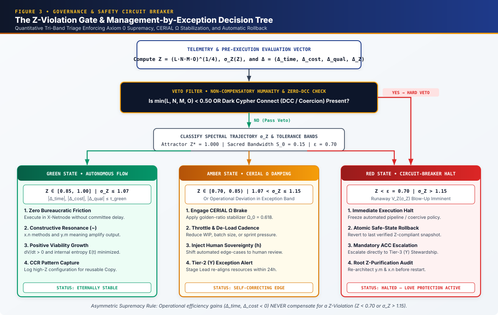

<div align="center">


# CSPA / EPCSIS-P v2.0 — Operational Blueprint, Visual Assets & Field Templates (`csi-process-blueprint/`)

### Compiled Handouts, Vector Architecture Diagrams, RK4 Phase-Space Plots & 1-Page Operational Canvases

[](./2026-11-25%20CSI_Process_Blueprint_by_Sebastian.Enger.pdf)
[](./CSI_Process_Blueprint.html)
[-059669?style=for-the-badge)](#2-ready-to-use-1-page-field-templates-templates)
[](../philosophy/The_Z_Theorem_Universal_Stability_Law.md)

**Author & Principal Architect:** Sebastian Enger, B.Sc., M.Sc.  
[← Back to Repository Root](../README.md) • [Foundational CSI & Z-Theorem Corpus (`philosophy/`)](../philosophy/README.md)

</div>

---

## Package Overview

This directory contains the complete, self-contained **operational deliverable suite** of the **Cerial Semantic Process Architecture (`CSPA / EPCSIS-P v2.0`)**—synthesizing purified **ITIL 4**, **PRINCE2 (7th Edition)**, and **Design Thinking** mechanics under the non-negotiable **[Z-Violation Law](../philosophy/The_Z_Theorem_Universal_Stability_Law.md)**.

Every file in this folder is engineered for **zero-prerequisite adoption ($\le 60$ minutes)** and **100% offline reliability** across both **Enterprise Operations** and **Sovereign Daily Personal Life**.

---

## 1. Compiled Master Handouts

| File | Format | Key Capabilities & When to Use |
| :--- | :--- | :--- |
| **[2026-11-25 CSI_Process_Blueprint_by_Sebastian.Enger.pdf](./2026-11-25%20CSI_Process_Blueprint_by_Sebastian.Enger.pdf)** | `PDF` (`4.64 MB`, 19 A4 pp.) | **Official Print & Executive Release:** Paginated A4 field manual with full-bleed vector diagrams, RK4 plots, mathematical derivations (`Eq. 1`–`Eq. 7`), and worked numerical proofs. Ready for direct distribution or physical printing. |
| **[CSI_Process_Blueprint.html](./CSI_Process_Blueprint.html)** | `HTML5 + MathML` | **Interactive Workstation Edition:** Self-contained single-page application (`0` external CDN dependencies) featuring a sticky section TOC, Light/Dark theme switch, `@media print` CSS, and an interactive **Live Z-Violation Gate Calculator**. |
| **[CSI_Process_Blueprint.md](./CSI_Process_Blueprint.md)** | `Markdown + LaTeX` | **GitHub & Version-Control Edition:** Native GitHub Markdown mirror containing clean LaTeX math blocks, Mermaid state-machine source diagrams, and relative links to `./assets/` and `./templates/`. |

> [!TIP]
> **Using the Interactive Live Z-Calculator:**  
> Open [`CSI_Process_Blueprint.html`](./CSI_Process_Blueprint.html) locally in any desktop browser and scroll to **Section 05**. Drag the four humanity sliders ($L, N, M, O \in [0,1]$) to observe real-time computation of the geometric invariant $Z$, spectral trajectory index $\sigma_Z$, runaway instability penalty $V_Z(\sigma_Z)$, and automatic **Green / Amber CERIAL $\Omega$ / Red Circuit-Breaker** triage.

---

## 2. Ready-to-Use 1-Page Field Templates (`./templates/`)

Each operational template is provided in both **GitHub Markdown (`.md`)** for repository/wiki workflows and **A4 Print-Optimized HTML (`.html`)** for browser/PDF sign-off:

| Template | Markdown | Print HTML | Operational Scope |
| :--- | :---: | :---: | :--- |
| **1. Enterprise Process Canvas** | [`Enterprise_Process_Canvas.md`](./templates/Enterprise_Process_Canvas.md) | [`Enterprise_Process_Canvas.html`](./templates/Enterprise_Process_Canvas.html) | End-to-end 1-page specification for engineering squads, IT/SRE value streams, CI/CD change gates, cross-team `LCC` APIs, and bounded `EPCSIS = Z[N+1]` AI agent pipelines. |
| **2. Daily Life Process Canvas** | [`Daily_Life_Process_Canvas.md`](./templates/Daily_Life_Process_Canvas.md) | [`Daily_Life_Process_Canvas.html`](./templates/Daily_Life_Process_Canvas.html) | Sovereign personal architecture canvas governing **M.E.A.T.** (*Money, Energy, Attention, Time*) protection, the `5:30–22:15` dual-aspect cadence, solo deep-work sprints, and zero-`DCC` boundaries. |
| **3. Z-Violation Audit Checklist** | [`Z_Violation_Audit_Checklist.md`](./templates/Z_Violation_Audit_Checklist.md) | [`Z_Violation_Audit_Checklist.html`](./templates/Z_Violation_Audit_Checklist.html) | Universal 12-point pre-flight scorecard enforcing the 4 Hard Vetoes ($\min(L,N,M,O) \ge 0.50$, zero `DCC`, `< 60s` rollback, AI Z-Law guard) plus a quick-reference $Z \leftrightarrow \sigma_Z$ table. |

### Dual-Scale Execution Visuals

<table>
  <tr>
    <td width="50%" align="center">
      <br/>
      <strong>Scale A — Enterprise &amp; Corporate Mode</strong><br/>
      <sub>Autonomous squads, SRE/IT ops, 15-min Z-Stage Gates &amp; shielded AI</sub>
    </td>
    <td width="50%" align="center">
      <br/>
      <strong>Scale B — Sovereign Daily Life Mode</strong><br/>
      <sub>M.E.A.T. resource shield, 5:30–22:15 cadence &amp; weekly CCR compounding</sub>
    </td>
  </tr>
</table>

---

## 3. 60-Minute Adoption Workflow


*Note: Follow Section 07 of [`CSI_Process_Blueprint.md`](./CSI_Process_Blueprint.md) alongside the three templates in [`./templates/`](./templates/) to take any workflow live in one hour.*

---

## 4. Technical Figures & Numerical Plots (`./assets/`)

All architectural diagrams (`fig1`–`fig4`) are precision XML-validated vector SVGs, and all mathematical plots (`fig5`–`fig6`) are supplied in both scalable **SVG** and **2× High-DPI PNG** formats:

| Figure | Asset Links | Technical Specification |
| :--- | :--- | :--- |
| **Figure 1** | [`fig1_architecture_stack.svg`](./assets/fig1_architecture_stack.svg) | **The 5-Layer CSPA Stack:** Maps Layer 0 (`Axiom 0`), Layer 1 (`PCSD` & `Trinity x.n ~ y.m`), Layer 2 (Purified Design Thinking / PRINCE2 / ITIL 4 DNA), Layer 3 (`EPCSIS = Z[N+1]` Pillars), and Layer 4 (Dual Scales). |
| **Figure 2** | [`fig2_master_workflow.svg`](./assets/fig2_master_workflow.svg) | **4-Swimlane Master State Machine:** Closed-loop execution pipeline from `LCC` Human Need Sensing through the Z-Gate, Bounded Execution, Live $\sigma_Z$ Telemetry, and `CCR` Evolution. |
| **Figure 3** | [`fig3_z_violation_gate.svg`](./assets/fig3_z_violation_gate.svg) | **Z-Violation Gate & Circuit-Breaker Tree:** Non-compensatory Veto filter followed by Green ($\sigma_Z \le 1.07$), Amber CERIAL $\Omega$ ($1.07 < \sigma_Z \le 1.15$), and Red Halt ($\sigma_Z > 1.15$) triage. |
| **Figure 4** | [`fig4_fractal_dual_scale.svg`](./assets/fig4_fractal_dual_scale.svg) | **Fractal Dual-Scale Mapping:** Structural 1-to-1 isomorphism across `ϒ`, `Y = N+1`, `X`, `Z = (L,N,M,O)`, `LCC/FCC/ACC`, and `CCR + CERIAL Ω` between corporate and personal scales. |
| **Figure 5** | [`SVG`](./assets/fig5_phase_space_z_boundary.svg) • [`PNG`](./assets/fig5_phase_space_z_boundary.png) | **RK4 Phase-Space & Spectral Runaway Plot:** 4th-order Runge-Kutta trajectories in $(Z, V)$ viability space (Panel A) paired with $\log_{10}(1 + V_Z(\sigma_Z))$ blow-up dynamics (Panel B). |
| **Figure 6** | [`SVG`](./assets/fig6_automation_sovereignty_matrix.svg) • [`PNG`](./assets/fig6_automation_sovereignty_matrix.png) | **Automation Sovereignty Matrix:** 2D control-stability map ($C_{x.n}$ vs. $S_{y.m}$) with critical human damping contours ($h_{\text{crit}}$) and the mandatory **AI Safety Z-Law Veto** zone ($S_{y.m} \ge 0.86$). |

<p align="center">
  
</p>

---

## 5. Deterministic Build & Export Scripts (`./scripts/`)

Both generator scripts in [`./scripts/`](./scripts/) are deterministic and self-validating:

* **[`generate_visual_assets.py`](./scripts/generate_visual_assets.py):** Computes the RK4 phase-space trajectories, spectral runaway curves, and human-damping contours using `numpy`, writes `fig1`–`fig6` into `./assets/`, and validates every output via `xml.etree.ElementTree`.
* **[`render_pdf.py`](./scripts/render_pdf.py):** Launches headless Chrome/Edge over the Chrome DevTools Protocol (`websockets`), verifies that all 9 embedded visual assets decode cleanly and responsive viewport constraints hold, exports the paginated A4 PDF handout, and captures `2x` high-DPI PNG mirrors of `fig5` and `fig6`.

```bash
# Regenerate all 6 vector SVG diagrams & numerical plots
python csi-process-blueprint/scripts/generate_visual_assets.py

# Re-export multi-page A4 PDF and 2x DPI PNG plots via Headless Chrome/Edge CDP
python csi-process-blueprint/scripts/render_pdf.py
```

---

## Directory Contents

```text
csi-process-blueprint/
├── README.md                                                 # Operational package guide & asset index
├── 2026-11-25 CSI_Process_Blueprint_by_Sebastian.Enger.pdf   # Official 19-page A4 Master PDF Handout
├── CSI_Process_Blueprint.html                                # Interactive offline HTML5 + MathML + Live Z-Calc
├── CSI_Process_Blueprint.md                                  # Archival Markdown + LaTeX + Mermaid mirror
├── assets/
│   ├── cover_hero_blueprint.jpg                              # Blueprint cover artwork
│   ├── banner_enterprise_scale.jpg                           # Scale A (Enterprise Operations) visual header
│   ├── banner_dailylife_scale.jpg                            # Scale B (Sovereign Daily Life) visual header
│   ├── fig1_architecture_stack.svg                           # Figure 1: 5-Layer CSPA Architecture Stack
│   ├── fig2_master_workflow.svg                              # Figure 2: End-to-End 4-Swimlane Workflow
│   ├── fig3_z_violation_gate.svg                             # Figure 3: Tri-Band Z-Gate & Circuit Breaker
│   ├── fig4_fractal_dual_scale.svg                           # Figure 4: Enterprise <-> Daily Life Isomorphism
│   ├── fig5_phase_space_z_boundary.{svg,png}                 # Figure 5: RK4 Phase Portrait & Runaway Boundary
│   └── fig6_automation_sovereignty_matrix.{svg,png}          # Figure 6: 2D Automation Sovereignty Matrix
├── scripts/
│   ├── generate_visual_assets.py                             # Precision SVG & RK4 plot generator
│   └── render_pdf.py                                         # Headless Chromium CDP PDF & PNG exporter
└── templates/
    ├── Enterprise_Process_Canvas.{md,html}                   # 1-page Enterprise Process Charter & Stage Gate
    ├── Daily_Life_Process_Canvas.{md,html}                   # 1-page Sovereign Daily Life & M.E.A.T. Canvas
    └── Z_Violation_Audit_Checklist.{md,html}                 # 12-point Pre-Flight Z-Audit Scorecard
```

---

<div align="center">
  <em>Grounded in Cypher Semantic Intelligence &amp; The Z-Theorem by Sebastian Enger, B.Sc., M.Sc.</em><br/>
  <em>"Omnia vincit amor • Check, Copy, Release — Simply always getting better."</em>
</div>

