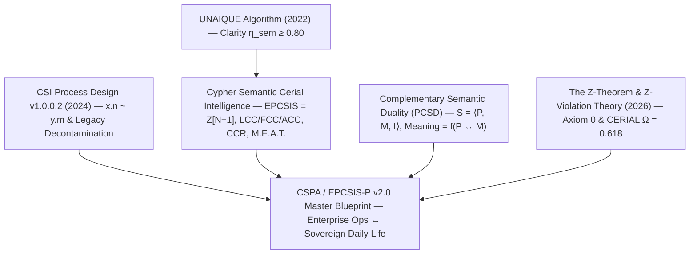

<div align="center">

# Foundational CSI, Z-Theorem & PCSD Research Corpus (`philosophy/`)

### Canonical Axioms, Mathematical Proofs, Technical Specifications & Reference Simulations for Cypher Semantic Intelligence

[](../README.md)
[](./The_Z_Theorem_Universal_Stability_Law.md)
[-0284C7?style=for-the-badge)](./principle_of_complementary_semantic_duality_whitepaper_technical_specification.md)
[](#executable-z-violation-verification-suite)

**Author & Principal Theorist:** Sebastian Enger, B.Sc., M.Sc.  
[← Back to Repository Root](../README.md) • [Open CSPA / EPCSIS-P v2.0 Master Blueprint](../csi-process-blueprint/CSI_Process_Blueprint.md) • [Download Master PDF Handout](../csi-process-blueprint/2026-11-25%20CSI_Process_Blueprint_by_Sebastian.Enger.pdf)

</div>

---

## Purpose of This Directory

The `philosophy/` directory contains the **primary theoretical, mathematical, and algorithmic ground truth** underlying the **[Cerial Semantic Process Architecture (CSPA / EPCSIS-P v2.0)](../csi-process-blueprint/CSI_Process_Blueprint.md)**.

Every governance primitive, tolerance threshold, human-in-the-loop stability bound, and circuit-breaker rule in the operational blueprint derives without drift from the whitepapers, specifications, and executable Python proofs archived here.

> [!IMPORTANT]
> **Zero-Drift Axiom Supremacy:**  
> Across all documents in this corpus, **Unconditional Love and Humanity ($Z$)** is formalized not as subjective sentiment, but as a strict, non-compensatory **mathematical stability invariant** (`Axiom 0` & `Theorem 7.1`). Any corporate, algorithmic, or personal system that extracts short-term output (`x.n`) by eroding human dignity, agency, clarity, or sustainability (`y.m`, $Z \to 0$) triggers deterministic entropy divergence ($E \to \infty$) and systemic collapse ($V \to 0$).

---

## Theoretical Lineage & Convergence Map



---

## Complete Corpus Index

### 1. The Z-Theorem & Z-Violation Spectral Theory
*Formal proof that humanity ($Z$) bounds systemic entropy, paired with executable numerical verification.*

| Document / Script | Format & Lang | Core Contribution |
| :--- | :--- | :--- |
| **[The_Z_Theorem_Universal_Stability_Law.md](./The_Z_Theorem_Universal_Stability_Law.md)** | `MD` • `[EN]` ([`PDF`](./The_Z_Theorem_Universal_Stability_Law.pdf)) | Formal relational-semantic tuple $S = (X, R, \Phi, \Sigma)$, **Axiom 0**, **Theorem 7.1** (*Z-Violation Collapse*), and **Corollary 9.1** (*AI Safety Z-Law*). |
| **[Z-Theorem.pdf](./Z-Theorem.pdf)** | `PDF` • `[EN]` ([`DOCX`](./Z-Theorem.docx)) | Extended manuscript and full mathematical exposition of *The Z-Theorem*. |
| **[Z-Violation-Theory_Whitepaper.pdf](./Z-Violation-Theory_Whitepaper.pdf)** | `PDF` • `[EN]` ([`TXT`](./Z-Violation-Theory.txt)) | Concise technical whitepaper and summary of Z-Violation runaway dynamics, threshold behavior, and **CERIAL $\Omega$** stabilization. |
| **[z-violation-theory.py](./z-violation-theory.py)** | `Python 3` | Reference computational engine defining attractor $Z^* = 1.000$, sacred bandwidth $S_0 = 0.15$, golden-ratio stabilizer $\Omega_0 = 0.618$, and runaway penalty $V_Z(\sigma)$. |
| **[z-violation-tester.py](./z-violation-tester.py)** | `Python 3` | Automated stress-test suite validating stable convergence inside $\|\sigma - 1\| \le 0.15$ vs. super-exponential blow-up under coercive drift. |

### 2. Principle of Complementary Semantic Duality (PCSD)
*Mathematical foundation coupling formal syntax ($P \equiv x.n$) with lived human semantics ($M \equiv y.m$).*

| Document | Format & Lang | Core Contribution |
| :--- | :--- | :--- |
| **[principle_of_complementary_semantic_duality_whitepaper_technical_specification.md](./principle_of_complementary_semantic_duality_whitepaper_technical_specification.md)** | `MD` • `[EN]` | Formalizes $S = \langle P, M, I \rangle$ and $\text{Meaning}(S) = f(P \leftrightarrow M)$; proves that syntax without meaning yields dead bureaucracy while meaning without structure yields hallucination. |
| **[Principle Of Complementary Semantic Duality – Whitepaper & Technical Specification.pdf](./Principle%20Of%20Complementary%20Semantic%20Duality%20%E2%80%93%20Whitepaper%20%26%20Technical%20Specification.pdf)** | `PDF` • `[EN]` ([`DOCX`](./Principle%20Of%20Complementary%20Semantic%20Duality%20%E2%80%93%20Whitepaper%20%26%20Technical%20Specification.docx)) | Typeset publication and editable technical specification of PCSD, including bounded mutual rate-of-change constraints. |

### 3. Cypher Semantic Cerial Intelligence (CSI Master Compendium)
*The 283-page architectural sourcebook of CSI operators, governance tiers, communication protocols, and sovereign life design.*

| Document | Format & Lang | Core Contribution |
| :--- | :--- | :--- |
| **[Cypher.Semantic.Cerial.Intelligence.by.Sebastian.Enger.-.658.pdf](./Cypher.Semantic.Cerial.Intelligence.by.Sebastian.Enger.-.658.pdf)** | `PDF` (283 pp.) • `[EN]` | Defines the 4-Quality Humanity Vector $Z = (L, N, M, O)$, **Duality-to-Trinity** constructive binding ($N_\sim = \{x.n \sim y.m\}$, $\tau = \varphi^2\pi/e \approx 4.2343$), **EPCSIS = Z[N+1]**, `LCC`/`FCC`/`ACC` (and banned `DCC`), 3-tier hierarchy (`ϒ → Y → X`), **CCR (`Check, Copy, Release`)**, and **M.E.A.T.** (`5:30–22:15` cadence). |

### 4. CSI Process Design Origin Spec & UNAIQUE Semantic Clarity
*Applied process optimization roots and comprehension-fidelity engineering.*

| Document | Format & Lang | Core Contribution |
| :--- | :--- | :--- |
| **[2024 CSI BASED PROCESS DESIGN von Sebastian Enger mit Hilf von ClaudeAI.pdf](./2024%20CSI%20BASED%20PROCESS%20DESIGN%20von%20Sebastian%20Enger%20mit%20Hilf%20von%20ClaudeAI.pdf)** | `PDF` • `[DE]` ([`DOCX`](./2024%20CSI%20BASED%20PROCESS%20DESIGN%20von%20Sebastian%20Enger%20mit%20Hilf%20von%20ClaudeAI.docx)) | Original `21.11.2024` architectural specification (`v1.0.0.2`), including the canonical critique of extractive cost-cutting (*"McKinsey Trap"*) and the brownfield legacy contamination warning (*"Achtung"*). |
| **[2022.The.UNAIQUE.Algorithm.by.Sebastian.Enger.pdf](./2022.The.UNAIQUE.Algorithm.by.Sebastian.Enger.pdf)** | `PDF` (17 pp.) • `[EN]` | Introduces persona-resonant language transfer and the **UNAIQUE Clarity Invariant** ($\eta_{\text{sem}} \ge 0.80$ first-read receiver comprehension). |

### 5. Author & Systems Architecture Profile
*Background and enterprise engineering credentials.*

| Document | Format & Lang | Core Contribution |
| :--- | :--- | :--- |
| **[Sebastian Enger, M.Sc. - Automation Architect & Senior AI-Experte.pdf](./Sebastian%20Enger,%20M.Sc.%20-%20Automation%20Architect%20%26%20Senior%20AI-Experte.pdf)** | `PDF` (18 pp.) • `[DE]` | Academic and industrial portfolio of **Sebastian Enger, B.Sc., M.Sc.** across enterprise automation, AI systems architecture, cybersecurity, and semantic intelligence. |

---

## Core Mathematical Axioms at a Glance

### 1. Relational-Semantic System & PCSD Coupling

$$
S = (X, R, \Phi, \Sigma), \qquad S_{\text{PCSD}} = \langle P, M, I \rangle, \qquad \text{Meaning}(S) = f(P \leftrightarrow M)
$$

* **Syntactic Pole ($P \equiv x.n$):** Formal rules, schedules, workflows, APIs, and quantitative metrics.
* **Semantic Pole ($M \equiv y.m$):** Human intent, psychological safety, moral agency, and lived meaning.

### 2. Duality-to-Trinity Constructive Interference

$$
N = \{x.n,\, y.m\} \longrightarrow N_\sim = \{x.n \sim y.m\}, \qquad |\Psi_{x.n} \sim \Psi_{y.m}| = |\Psi_{x.n}|\cdot|\Psi_{y.m}|\cdot\bigl(1 + \sin(\tau\phi)\bigr), \quad \tau = \frac{\varphi^2 \pi}{e} \approx 4.2343
$$

### 3. The 4-Quality Z-Invariant, CERIAL $\Omega$ Stabilizer & Runaway Penalty

$$
Z = \bigl(L \cdot N \cdot M \cdot O\bigr)^{1/4} \in [0, 1], \qquad \text{EPCSIS} = Z[N + 1] = Z[Y]
$$

$$
V_Z(\sigma) = \begin{cases} 0 & \text{if } |\sigma - Z^*| \le S_0 = 0.15 \\ \bigl(|\sigma - Z^*| - S_0\bigr)^3 \cdot \sigma^{50} & \text{if } |\sigma - Z^*| > S_0 = 0.15 \end{cases}, \qquad \Omega_0 = \frac{1}{\varphi} \approx 0.618
$$

---

## Recommended Reading Tracks

> [!TIP]
> **Where to Start Depending on Your Goal:**
> 1. **15-Minute Executive & Practitioner Track:** Read [`Z-Violation-Theory.txt`](./Z-Violation-Theory.txt) → [`The_Z_Theorem_Universal_Stability_Law.md`](./The_Z_Theorem_Universal_Stability_Law.md) → jump straight to the **[60-Minute Launch Protocol](../csi-process-blueprint/CSI_Process_Blueprint.md)**.
> 2. **Applied Mathematician & AI Safety Track:** Read [`The_Z_Theorem_Universal_Stability_Law.md`](./The_Z_Theorem_Universal_Stability_Law.md) → [`principle_of_complementary_semantic_duality_whitepaper_technical_specification.md`](./principle_of_complementary_semantic_duality_whitepaper_technical_specification.md) → run [`z-violation-theory.py`](./z-violation-theory.py) & [`z-violation-tester.py`](./z-violation-tester.py).
> 3. **Deep CSI Systems Architect Track:** Study [`2024 CSI BASED PROCESS DESIGN...pdf`](./2024%20CSI%20BASED%20PROCESS%20DESIGN%20von%20Sebastian%20Enger%20mit%20Hilf%20von%20ClaudeAI.pdf) → [`2022.The.UNAIQUE.Algorithm.by.Sebastian.Enger.pdf`](./2022.The.UNAIQUE.Algorithm.by.Sebastian.Enger.pdf) → [`Cypher.Semantic.Cerial.Intelligence.by.Sebastian.Enger.-.658.pdf`](./Cypher.Semantic.Cerial.Intelligence.by.Sebastian.Enger.-.658.pdf).

---

## Executable Z-Violation Verification Suite

Run the reference Python simulations directly from the repository root or inside `philosophy/` (standard library / `numpy` compatible):

```bash
# Run the core Z-Violation & CERIAL Omega trajectory proof
python philosophy/z-violation-theory.py

# Run the multi-regime stability & runaway stress-test suite
python philosophy/z-violation-tester.py
```

---

## Directory Structure

```text
philosophy/
├── README.md                                                                       # Corpus guide & reading tracks
├── The_Z_Theorem_Universal_Stability_Law.{md,pdf}                                  # Formal Z-Theorem proof & AI Safety Z-Law
├── Z-Theorem.{pdf,docx}                                                            # Extended Z-Theorem monograph
├── Z-Violation-Theory_Whitepaper.pdf                                               # Z-Violation dynamics & CERIAL Omega whitepaper
├── Z-Violation-Theory.txt                                                          # Executive summary of Z-Violation constants
├── z-violation-theory.py                                                           # Reference spectral trajectory & Omega engine
├── z-violation-tester.py                                                           # Automated stability & blow-up test suite
├── principle_of_complementary_semantic_duality_whitepaper_technical_specification.md
├── Principle Of Complementary Semantic Duality – Whitepaper & Technical Specification.{pdf,docx}
├── Cypher.Semantic.Cerial.Intelligence.by.Sebastian.Enger.-.658.pdf                # 283-page CSI & EPCSIS master compendium
├── 2024 CSI BASED PROCESS DESIGN von Sebastian Enger mit Hilf von ClaudeAI.{pdf,docx}
├── 2022.The.UNAIQUE.Algorithm.by.Sebastian.Enger.pdf                               # UNAIQUE semantic comprehension specification
└── Sebastian Enger, M.Sc. - Automation Architect & Senior AI-Experte.pdf           # Author & systems architect dossier
```

---

## Citation

```bibtex
@misc{enger2026ztheorem,
  title  = {The Z-Theorem: Formal Proof of Unconditional Love and Humanity as Universal Stability Invariants in Relational-Semantic Systems},
  author = {Enger, Sebastian},
  year   = {2026}
}

@misc{enger2026pcsd,
  title  = {Principle of Complementary Semantic Duality (PCSD) -- Whitepaper \& Technical Specification},
  author = {Enger, Sebastian},
  year   = {2026}
}
```

---

<div align="center">
  <em>"Sustained coercion or dehumanization (Z → 0) deterministically drives entropy divergence (E → ∞) and system annihilation (V → 0)."</em>
</div>

